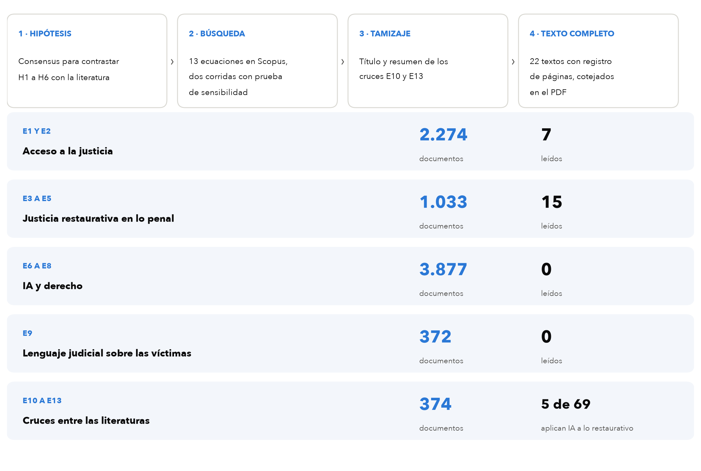
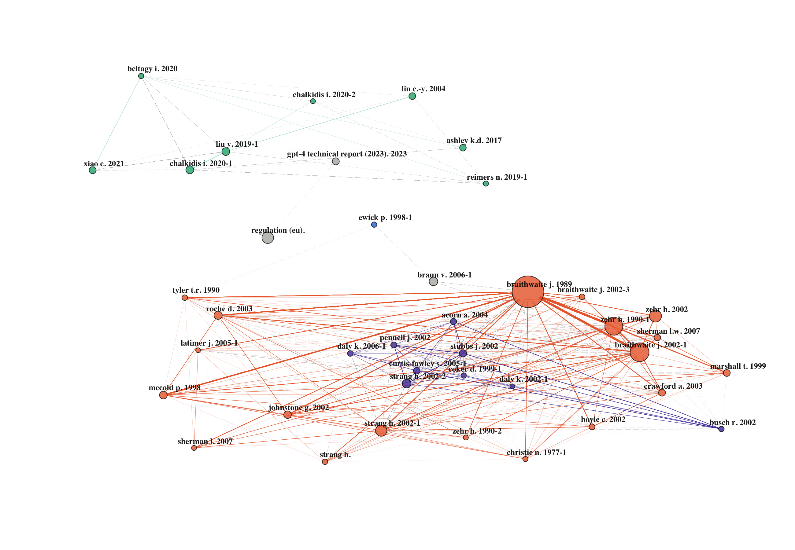
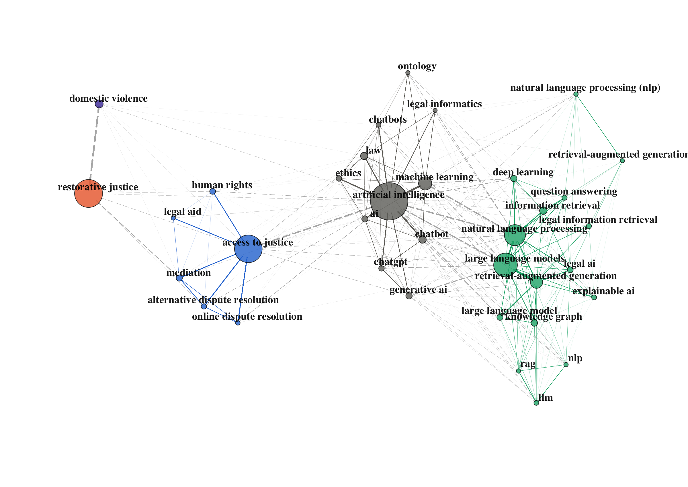
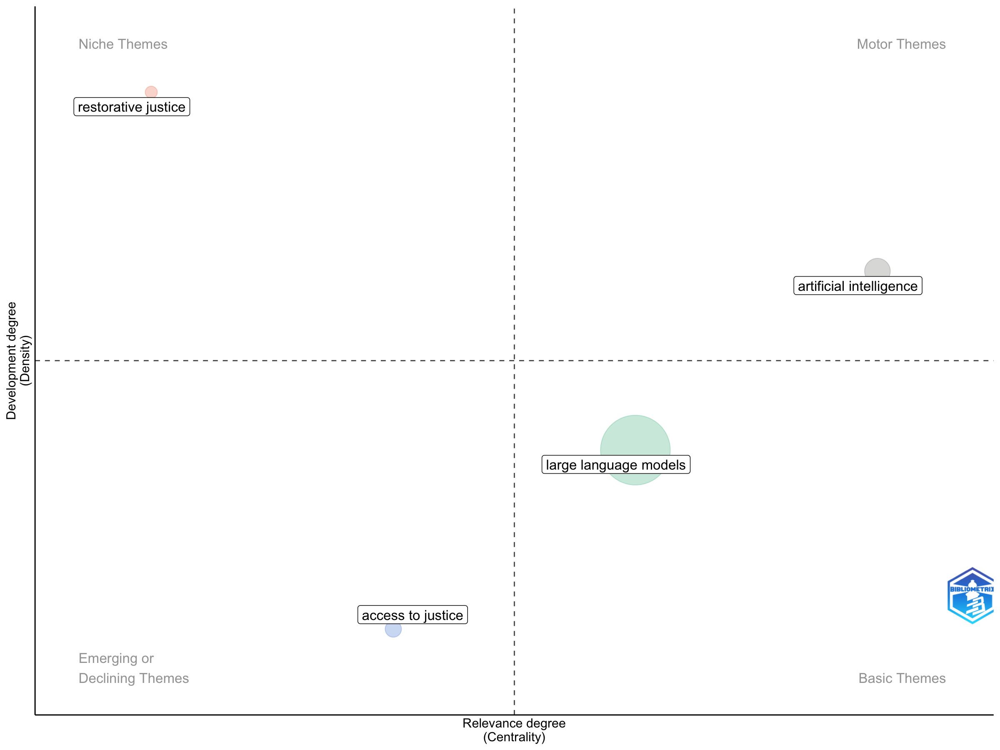
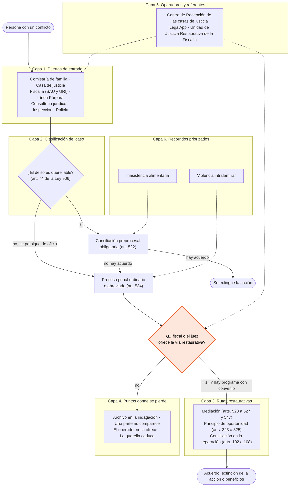
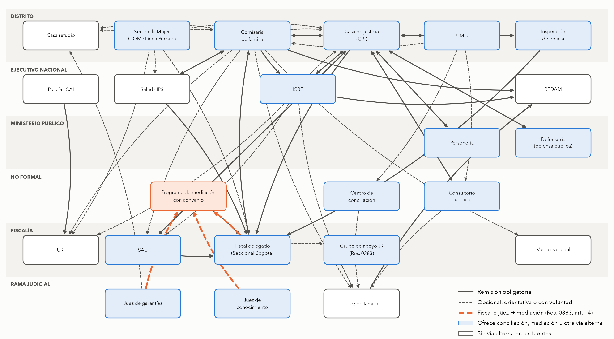
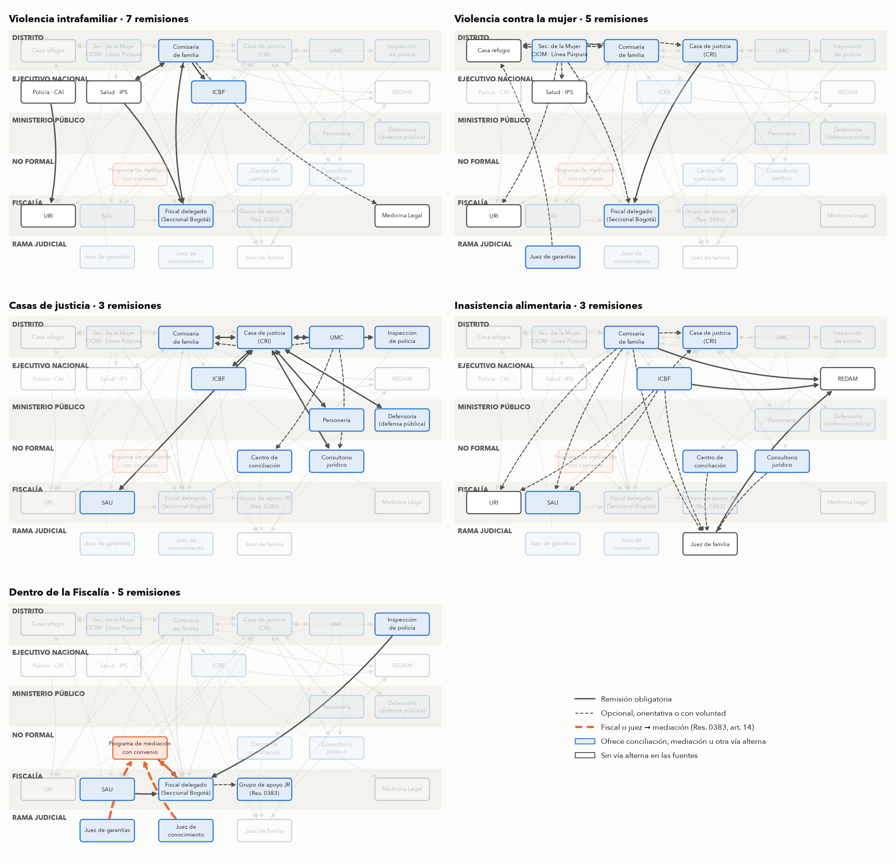

# Justicia restaurativa e inteligencia artificial en Bogotá

Estado del arte y mapa del Leviatán · Proyecto 21871 «Tecnología para fortalecer el acceso y la restauración en la justicia» · Alianza CAOBA y Pontificia Universidad Javeriana · Noviembre de 2026

## Resumen

El proyecto 21871, del programa Atenea, explora cómo un agente de inteligencia artificial puede ayudar a que las personas en Bogotá lleguen a la justicia y, cuando corresponde, a la vía restaurativa. Para situarlo se revisaron tres literaturas que hoy se estudian por separado: el acceso a la justicia, la justicia restaurativa en lo penal y la inteligencia artificial aplicada al derecho, a las que se suma el lenguaje judicial sobre las víctimas. Trece ecuaciones en Scopus reunieron 7.930 documentos distintos, y la lectura en texto completo de 22 de ellos permitió contrastar las hipótesis del equipo. Cada literatura tiene un cuerpo propio, pero casi no se citan entre sí: entre la justicia restaurativa y la inteligencia artificial solo el 0,03% de los pares de documentos comparte una referencia, y de los 57 documentos que las cruzan apenas cinco aplican la IA a un proceso restaurativo penal, ninguno para orientar a la ciudadanía ni para derivar casos. En paralelo se bajó el Leviatán, es decir, el sistema de justicia bogotano, a 42 entidades, 14 etapas procesales y 24 remisiones con su norma, lo que muestra que en lo penal la vía restaurativa solo se abre cuando un fiscal o un juez la ofrece.

## Contenido

1. [Desafío planteado](#1-desafío-planteado)
2. [Universo relevante](#2-universo-relevante)
3. [Cuánto se leen entre sí las literaturas](#3-cuánto-se-leen-entre-sí-las-literaturas)
4. [Cómo se organiza cada literatura](#4-cómo-se-organiza-cada-literatura)
5. [Lo que sostiene la lectura completa](#5-lo-que-sostiene-la-lectura-completa)
6. [Vacío en la literatura](#6-vacío-en-la-literatura)
7. [El mapa del Leviatán](#7-el-mapa-del-leviatán)
8. [Pendientes](#8-pendientes)
9. [Organización del repositorio](#9-organización-del-repositorio)
10. [Referencias](#10-referencias)

## 1. Desafío planteado

El proyecto partió de un supuesto que comparte buena parte del sector: la gente no llega a la justicia porque no sabe a qué entidad acudir. Sin embargo, los datos de Colombia matizan ese supuesto. Según el PNUD y el DNP (2023), en el 44% de los problemas justiciables las personas no hicieron nada para resolverlos, y en el caso de los delitos solo el 4% de quienes no actuaron dijo no saber a dónde ir, mientras que el 36% creyó que no valía la pena, el 21% no confiaba en las autoridades y el 20% no tenía pruebas (la lectura de las columnas del gráfico del informe es propia). En otras palabras, la barrera principal en lo penal no está en la puerta, sino en lo que la persona espera encontrar detrás de ella.

Por otra parte, la vía restaurativa no depende solo de la ciudadanía. En Colombia la mediación penal es voluntaria y requiere que un operador la ofrezca, de modo que un agente que oriente a las personas tiene que entender también dónde se decide la ruta de un caso y quién la decide. A eso se suma que la inteligencia artificial jurídica todavía inventa información con frecuencia (Dahl y colegas, 2024), lo que obliga a preguntarse qué puede decir un agente sin poner en riesgo a quien lo consulta. Es por esto que el desafío es diseñar un agente que oriente sobre el sistema de justicia de Bogotá con información fiable, que haga visible la vía restaurativa donde la ley la permite y que reconozca sus límites, en particular en la violencia intrafamiliar. Para ello hay que responder por qué las personas no llegan, dónde y quién decide la vía restaurativa, y qué tan fiable es hoy la IA que informa sobre derecho.

## 2. Universo relevante

La revisión se hizo en tres pasos. Primero, Consensus AI sirvió para contrastar las seis hipótesis del equipo con la literatura e identificar los trabajos que las respaldan o las discuten. Después, trece ecuaciones en Scopus, numeradas de E1 a E13, permitieron ampliar la búsqueda de forma sistemática y comprobar que se recuperaran artículos conocidos de antemano. Por último, los documentos de los cruces se tamizaron por título y resumen, y los 22 textos más cercanos a las hipótesis se leyeron completos. La Figura 1 muestra ese recorrido y lo que quedó en cada literatura.

**Figura 1.** Recorrido de la búsqueda y lo que quedó en cada literatura



*Nota:* E1 a E13 son las ecuaciones de búsqueda en Scopus, en título, resumen y palabras clave, sin filtro de años, corridas el 2 de noviembre de 2026. Cada documento se asigna a una sola literatura según la ecuación que lo trajo, y los cruces tienen prioridad. Las ecuaciones completas y la prueba de sensibilidad están en [`protocolo.md`](estado-del-arte/busqueda/protocolo.md). *Fuente:* Elaboración propia.

Las trece ecuaciones devolvieron 9.268 resultados, que corresponden a 7.930 documentos distintos. La Tabla 1 resume qué pregunta cada ecuación y cuántos documentos trajo en la segunda corrida, que es la definitiva. Entre la primera y la segunda corrida se amplió el bloque de rutas de E1, que perdía dos artículos conocidos, y se quitaron dos términos genéricos de las ecuaciones de IA, que traían documentos ajenos al derecho.

**Tabla 1.** Ecuaciones de búsqueda y documentos por ecuación

| Ecuación | Pregunta | Documentos |
|---|---|---:|
| E1 | ¿Por qué la gente llega o no al sistema de justicia, y quién la orienta? | 1.814 |
| E2 | ¿Qué se sabe de las necesidades jurídicas en América Latina? | 806 |
| E3 | ¿Quién deriva a la vía restaurativa, con qué criterio y en qué etapa? | 789 |
| E4 | ¿Cabe la vía restaurativa en la violencia intrafamiliar? | 288 |
| E5 | ¿Qué efectos tiene, según los estudios de mejor diseño? | 52 |
| E6 | ¿Cómo se usa la IA para informar y orientar a la ciudadanía en asuntos jurídicos? | 2.667 |
| E7 | ¿Qué tan fiable es la IA en preguntas jurídicas? | 625 |
| E8 | ¿Cómo se representa el conocimiento jurídico para que una máquina lo use? | 1.465 |
| E9 | ¿Qué se ha medido del lenguaje judicial sobre las víctimas? | 374 |
| E10 | Cruce: IA y justicia restaurativa | 57 |
| E11 | Cruce: IA para orientar y derivar en el acceso a la justicia | 248 |
| E12 | Cruce: la vía restaurativa vista desde el acceso a la justicia | 71 |
| E13 | Cruce completo: IA, justicia restaurativa y acceso o derivación | 12 |

*Fuente:* Elaboración propia con datos de Scopus.

La lectura fue asistida por inteligencia artificial. Gemini Notebook extrajo los textos completos y Claude (Anthropic) cotejó contra cada PDF las citas que se usan aquí, con su página, además de tamizar los cruces por título y resumen. Felipe Soto definió las preguntas y las tres literaturas. Como muestra la Figura 1, los textos leídos completos pertenecen al acceso a la justicia y a la justicia restaurativa, mientras que de la IA jurídica y del lenguaje judicial todavía no hay ninguno, de manera que lo que aquí se dice de ellas proviene de la estructura del corpus y de los resúmenes.

## 3. Cuánto se leen entre sí las literaturas

Para saber si estas literaturas dialogan, se midió en cada par de documentos si comparten al menos una referencia citada, tanto dentro de cada literatura como entre ellas. Es la misma medida del mapa del campo de la tesis del autor, y su ventaja es que no depende de cómo se nombra cada tema, sino de a quién se cita. La Tabla 2 presenta el resultado.

**Tabla 2.** Pares de documentos que comparten al menos una referencia

| Grupos comparados | Comparten | Total de pares | % |
|---|---:|---:|---:|
| *Dentro de cada literatura* | | | |
| Acceso a la justicia (2.274 documentos) | 12.748 | 2.584.401 | 0,49% |
| Justicia restaurativa (1.033) | 41.682 | 533.028 | 7,82% |
| IA y derecho (3.877) | 166.051 | 7.513.626 | 2,21% |
| Lenguaje judicial (372) | 2.604 | 69.006 | 3,77% |
| *Entre literaturas* | | | |
| Lenguaje judicial × restaurativa | 3.518 | 384.276 | 0,92% |
| Acceso × restaurativa | 5.255 | 2.349.042 | 0,22% |
| Acceso × IA | 4.435 | 8.816.298 | 0,05% |
| Lenguaje judicial × IA | 756 | 1.442.244 | 0,05% |
| **Restaurativa × IA** | **1.032** | **4.004.941** | **0,03%** |

*Nota:* las referencias se comparan por sus primeros 60 caracteres normalizados. El cálculo está en [`corpus.py`](estado-del-arte/busqueda/corpus.py) y su salida completa en [`conexion.txt`](estado-del-arte/busqueda/conexion.txt). *Fuente:* Elaboración propia con datos de Scopus.

La justicia restaurativa es la literatura más cohesionada, ya que casi el 8% de sus pares de documentos comparte alguna referencia, mientras que el acceso a la justicia es la más dispersa, con menos del 0,5%. Entre literaturas, en cambio, los vínculos caen a fracciones mínimas, y el más débil es justamente el que interesa al proyecto: entre la justicia restaurativa y la inteligencia artificial, solo 3 de cada 10.000 pares comparten una referencia. Además, lo poco que comparten es método o teoría general y no hallazgos, porque las referencias comunes más frecuentes son manuales de análisis cualitativo (Braun y Clarke), de revisiones sistemáticas (PRISMA) y de potencia estadística (Cohen), junto con clásicos como Rawls, Hart y Tyler.

## 4. Cómo se organiza cada literatura

Las figuras de esta sección se construyeron con bibliometrix sobre los 7.930 documentos. La cocitación muestra qué referencias se citan juntas y, por lo tanto, la base intelectual de cada campo; las palabras clave muestran de qué hablan los documentos; y el mapa temático ubica cada tema según cuánto se conecta con los demás y cuánto se trabaja por dentro.

**Figura 2.** Cocitación de las 40 referencias más citadas del corpus



*Nota:* dos referencias se unen cuando un mismo documento las cita juntas; el tamaño del nodo es el número de cocitaciones y los grupos salen de la agrupación walktrap. Naranja, el canon de la justicia restaurativa; violeta, la crítica feminista a su uso en la violencia de género; aguamarina, la IA jurídica; azul, la conciencia jurídica; en gris, referencias que no forman grupo. *Fuente:* Elaboración propia con datos de Scopus.

La Figura 2 muestra dos islas. Abajo está la justicia restaurativa, que se divide en dos grupos muy unidos entre sí: el canon, con Braithwaite (1989), Zehr (1990), Strang (2002) y McCold (1998), al que se suma la justicia procedimental de Tyler (1990), y la crítica feminista a su uso en la violencia de género, con Stubbs, Daly, Coker y Acorn. Arriba, lejos, está la IA jurídica, que cita modelos de lenguaje adaptados al derecho (Chalkidis, Xiao, Beltagy), el manual de razonamiento jurídico computacional de Ashley (2017), el informe técnico de GPT-4 y el reglamento europeo de IA. Entre ambas queda sola la conciencia jurídica de Ewick y Silbey (1998), y las líneas que las cruzan son pocas y tenues. Cabe notar que la literatura de acceso a la justicia, aunque aporta 2.274 documentos, no alcanza a formar un grupo propio entre las referencias más citadas, lo que coincide con su baja cohesión en la Tabla 2.

**Figura 3.** Coocurrencia de las 35 palabras clave de autor más frecuentes



*Nota:* dos palabras se unen cuando aparecen en el mismo documento, con al menos dos coocurrencias por enlace. Azul, acceso a la justicia y mecanismos alternativos; naranja, justicia restaurativa; violeta, violencia intrafamiliar; gris oscuro, IA en general; aguamarina, modelos de lenguaje y recuperación de información. *Fuente:* Elaboración propia con datos de Scopus.

En las palabras clave la separación se repite, aunque con matices. El acceso a la justicia se agrupa con la mediación, la resolución alternativa y en línea de disputas y la asistencia legal, y desde ahí se conecta con la IA. La IA, a su vez, se divide en un grupo general (ética, chatbots, IA generativa) y uno técnico (modelos de lenguaje, generación aumentada por recuperación, grafos de conocimiento). En cambio, «restorative justice» y «domestic violence» quedan cada una sola en un borde de la red, unidas al resto por enlaces débiles, lo que indica que la justicia restaurativa casi no comparte vocabulario con la IA ni con el acceso a la justicia.

**Figura 4.** Mapa temático según centralidad y densidad



*Nota:* el eje horizontal es la centralidad, es decir, cuánto se conecta el tema con los demás, y el vertical es la densidad, es decir, cuánto se trabaja por dentro. Arriba a la izquierda están los temas de nicho, arriba a la derecha los motores, abajo a la derecha los básicos y abajo a la izquierda los emergentes o en declive. *Fuente:* Elaboración propia con datos de Scopus.

El mapa temático resume lo anterior. La justicia restaurativa es un tema de nicho, desarrollado por dentro pero desconectado del resto. La inteligencia artificial es un tema motor y los modelos de lenguaje uno básico, que conecta con todo pero se trabaja poco por dentro. El acceso a la justicia, por su parte, aparece con baja centralidad y baja densidad, lo que sugiere un campo amplio que no se articula alrededor de un vocabulario común. El agente que propone el proyecto trabaja precisamente entre el nicho restaurativo y el tema básico de los modelos de lenguaje.

## 5. Lo que sostiene la lectura completa

Los 22 textos leídos completos permitieron contrastar las hipótesis del equipo con los datos de cada estudio y no con sus resúmenes. Lo que sostienen se ordena en cinco movimientos, y un sexto describe la IA jurídica desde el corpus. El contraste detallado, hipótesis por hipótesis, está en [`contraste-hipotesis.md`](estado-del-arte/contraste-hipotesis.md).

### 5.1 La barrera no está en la puerta

La literatura sobre necesidades jurídicas coincide en que las personas dejan de actuar menos por no saber a dónde ir que por no reconocer su problema como jurídico o por creer que nada se puede hacer. En Inglaterra y Gales, el costo apareció en menos del 5% de las razones para no actuar, y en la violencia doméstica el 32% no actuó porque creía que no se podía hacer nada (Pleasence y colegas, 2003). En Estados Unidos, la razón principal es no ver el problema como legal (Sandefur, 2016). En Colombia, el dato del PNUD y el DNP (2023) va en la misma dirección, y Hilbink y colegas (2022) muestran, con grupos focales en Medellín y Santiago, que la desconfianza tampoco explica por sí sola la decisión de acudir, porque pesan más las expectativas y la capacidad de agencia legal. Guarin y colegas (2024) agregan que, entre las madres custodias de Colombia, las más vulnerables son las que más problemas de familia tienen y las que menos buscan ayuda institucional. Por lo tanto, un agente que solo indique la puerta atacaría la barrera menor, y lo que necesita es explicar qué se puede lograr y qué hace falta para lograrlo.

### 5.2 Orientar rinde cuando alguien acompaña

Las herramientas de orientación funcionan mejor con una persona al lado. En el tribunal en línea de Columbia Británica, al 80% de quienes tuvieron ayuda el sistema les resolvió todo o casi todo, frente al 17% de quienes lo usaron solos (Sykes y colegas, 2020). En Burundi, la asistencia legal de asesores locales aumentó el uso de los tribunales, pero no cambió el uso de los mecanismos alternativos (Chaara y colegas, 2022). De ahí que orientar no lleve por sí solo a la vía restaurativa, y que el agente rinda más desde una puerta con un orientador, como el Centro de Recepción e Información de las casas de justicia, que solo frente al ciudadano.

### 5.3 Quien deriva decide la vía restaurativa

En los países donde se ha estudiado, la derivación a la vía restaurativa depende del juicio del operador. Los policías de Países Bajos derivan por intuición y por su juicio moral sobre la víctima y el ofensor (Hoekstra, 2022); en Dinamarca la derivación es una formalidad que se olvida o se desconoce (Sandbye y colegas, 2023), y a quién se le informa siquiera de la mediación varía según el distrito y el policía (Rasmussen, 2020). En Colombia ocurre algo análogo, porque solo el fiscal o el juez pueden remitir un caso penal a mediación, y únicamente a un programa con convenio (Resolución 0383 de 2022 de la Fiscalía, artículo 14). En consecuencia, la elegibilidad se puede expresar como reglas que hagan visible el caso elegible, sin necesidad de un modelo predictivo.

### 5.4 Lo robusto es la satisfacción de la víctima

Los metaanálisis coinciden en que la justicia restaurativa mejora la experiencia de la víctima, pero no en cuánto reduce la reincidencia. Fulham y colegas (2025) encontraron una reducción de la reincidencia general cercana al 17%, que deja de ser significativa en la reincidencia violenta y en los ensayos aleatorios, mientras que el efecto sobre la satisfacción de la víctima es mayor (d = 0,63). La revisión Campbell de Strang y colegas (2013) halló efectos pequeños en reincidencia, algo mayores en delitos violentos y cercanos a cero en delitos contra la propiedad, e Islam y colegas (2023) sí encontraron un efecto significativo en los delitos violentos, a diferencia de Fulham. Por eso la medida más defendible para un piloto es la satisfacción y la justicia procedimental de quienes pasan por el proceso.

### 5.5 En la violencia intrafamiliar la evidencia no alcanza

La violencia intrafamiliar es el límite más claro. La revisión de Kettrey y Reynolds (2026) encontró solo cuatro estudios elegibles en violencia sexual y doméstica, con un efecto que no es significativo en los ensayos aleatorios y sin ninguna medición del bienestar de la víctima. Además, la práctica documentada es preocupante: en Inglaterra la policía usó el lenguaje restaurativo para cerrar casos sin más acción (Westmarland y colegas, 2018), en Brasil la invitación al círculo operó como una citación y las mujeres lo vivieron como terapia o reconciliación (De Campos y De Oliveira, 2021), y la revisión de Hudson y Berger (2026) identifica el desequilibrio de poder y la retraumatización como riesgos principales. Esto sugiere que la primera iteración del agente no debería ofrecer mediación en violencia intrafamiliar, y que la inasistencia alimentaria es un caso más seguro para empezar.

### 5.6 La IA jurídica construye mucho y evalúa poco

Esta parte se apoya en el corpus y en resúmenes, porque aún no hay textos leídos completos de esta literatura. El cruce E11 reúne 248 documentos sobre IA para el acceso a la justicia, de los cuales 196 son de 2023 en adelante, 114 son ponencias y 82 tienen al menos un autor en India. La mayoría describe un asistente o chatbot jurídico, pero solo unos pocos lo evalúan con usuarios, y apenas tres tratan de forma directa la clasificación y derivación de solicitudes, todos en asistencia legal civil (Mistica y colegas, 2021; Steenhuis y Westermann, 2024; Steenhuis, 2025). En paralelo, la fiabilidad sigue siendo el problema central: según sus resúmenes, las herramientas comerciales de investigación jurídica inventan información en una parte relevante de sus respuestas (Magesh y colegas, 2025) y los modelos generales lo hacen con más frecuencia y aceptan las premisas falsas del usuario (Dahl y colegas, 2024). Por último, de los 57 documentos que cruzan IA y justicia restaurativa, solo cinco aplican la IA a un proceso restaurativo penal: dos analizan señales no verbales en mediaciones víctima-ofensor (Ponce-López y colegas, 2013, 2015), uno estudia la IA en la mediación de procesos penales en China (Lu, 2025), uno compara juicios humanos y de IA sobre respuestas restaurativas al abuso sexual (Peleg-Koriat y Asraf, 2026) y uno simula intervenciones restaurativas con agentes (Ali y colegas, 2026). El tamizaje completo está en [`tamizaje-e10.csv`](estado-del-arte/busqueda/tamizaje-e10.csv).

## 6. Vacío en la literatura

La literatura revisada tiene las piezas del proyecto por separado. Por un lado, la literatura de acceso a la justicia explica por qué las personas no llegan y muestra que orientar rinde con acompañamiento, pero no trata la vía restaurativa. Por otro lado, la literatura restaurativa muestra quién decide derivar y dónde están los límites en la violencia intrafamiliar, pero no habla de inteligencia artificial. Por último, la IA jurídica construye asistentes que responden preguntas, pero casi no los evalúa con usuarios ni los conecta con las rutas restaurativas. La Figura 5 contrasta lo que cubre cada literatura con lo que el proyecto necesita reunir.

**Figura 5.** Lo que cubre cada literatura frente a lo que el proyecto necesita reunir

| Literatura | Explica por qué la gente no llega | Muestra quién decide la vía restaurativa | Fija límites en violencia intrafamiliar | Orienta con IA fiable | Representa el conocimiento jurídico para una máquina |
|---|:---:|:---:|:---:|:---:|:---:|
| Acceso a la justicia | ✓ | ~ | ✗ | ~ | ✗ |
| Justicia restaurativa | ~ | ✓ | ✓ | ✗ | ✗ |
| IA y derecho | ✗ | ✗ | ✗ | ~ | ✓ |
| Lenguaje judicial | ✗ | ✗ | ~ | ✗ | ✗ |
| Cruces entre literaturas | ~ | ✗ | ✗ | ~ | ✗ |
| **Este proyecto** | **✓** | **✓** | **✓** | **✓** | **✓** |

✓ lo estudia · ~ lo toca en parte · ✗ no lo estudia

*Evidencia de la búsqueda:* entre la justicia restaurativa y la IA comparte referencias el 0,03% de los pares de documentos; de los 57 documentos que las cruzan, cinco aplican la IA a un proceso restaurativo penal y ninguno a orientar o derivar.

*Nota:* las columnas son lo que el proyecto necesita reunir según el marco de análisis del equipo ([`marco-de-analisis.md`](marco-de-analisis.md)). *Fuente:* Elaboración propia a partir de las secciones 3 a 5.

Queda abierto, entonces, cómo un agente de IA puede orientar a las personas en Bogotá sobre el sistema de justicia con información fiable, hacer visible la vía restaurativa donde la ley la permite y dejarla fuera donde la evidencia no la respalda, apoyando al operador que decide en lugar de reemplazarlo.

## 7. El mapa del Leviatán

Para saber dónde podría intervenir el agente, el equipo decidió dibujar el sistema de justicia completo, con la analogía del sistema de salud: una persona entra por una puerta, alguien clasifica su caso y esa clasificación abre o cierra rutas. La Figura 6 sigue ese recorrido a través de las seis capas del mapa.

**Figura 6.** Recorrido de una persona por las seis capas del Leviatán



*Nota:* en naranja, el punto donde se decide la vía restaurativa. Los artículos son de la Ley 906 de 2004; el procedimiento abreviado es el de la Ley 1826 de 2017. *Fuente:* Elaboración propia a partir de [`leviatan.md`](leviatan.md) y [`leviatan-estructura.md`](leviatan-estructura.md).

El recorrido muestra que, una vez que un caso entra al proceso penal, la vía restaurativa depende de una sola decisión. La Figura 7 lo confirma desde las remisiones entre entidades, es decir, quién manda el caso a quién según la norma.

**Figura 7.** Remisiones entre las entidades del Leviatán



*Nota:* son 24 remisiones con su norma y cita, que dan 59 flechas al separar los destinos múltiples. Las entidades se ordenan por bloque del Estado; en azul, las que ofrecen conciliación, mediación u otra vía alterna. *Fuente:* Elaboración propia con datos de [`remisiones.csv`](mapa/remisiones.csv) y [`entidades.csv`](mapa/entidades.csv).

La red muestra que toda la violencia intrafamiliar termina en el fiscal, porque la comisaría está obligada a remitir todos los casos a la Fiscalía (Ley 2126 de 2021, artículo 17), y que la única entrada formal a la mediación penal es la flecha naranja que va del fiscal o el juez al programa con convenio. Ni la comisaría ni la casa de justicia pueden mandar un caso penal a mediación, y las unidades de mediación del Distrito excluyen la violencia física. La Figura 8 separa la misma red por tipo de conflicto.

**Figura 8.** La red de remisiones, una ruta por panel



*Nota:* en gris claro, las remisiones de las otras rutas; atenuadas, las entidades que la ruta no toca. *Fuente:* Elaboración propia con datos de [`remisiones.csv`](mapa/remisiones.csv).

Al separar las rutas se ve que cada conflicto tiene una forma distinta. En la violencia intrafamiliar todo converge en el fiscal, mientras que en las casas de justicia el Centro de Recepción reparte el caso entre ocho entidades y en la inasistencia alimentaria hay dos caminos paralelos, cobrar ante el juez de familia o denunciar. Esa diferencia importa para el agente, porque en alimentos la conciliación ocurre antes del incumplimiento y fuera de lo penal, lo que la hace el punto restaurativo más accesible para una primera iteración.

## 8. Pendientes

La revisión deja tareas concretas, que la Tabla 3 ordena por responsable.

**Tabla 3.** Pendientes de la investigación

| Qué | Quién | Para cuándo |
|---|---|---|
| Leer en texto completo los documentos clave de IA jurídica (E6 a E8) y de lenguaje judicial (E9), con registro de páginas | Felipe Soto | Sprint S3, hasta el 15 de noviembre |
| Tamizar E11 y E12 por título y resumen con criterios explícitos | Felipe Soto | Sprint S3 |
| Llevar al equipo el cambio en la hipótesis de comprensión y decidir si el agente va en la puerta o con el operador | Felipe Soto con el equipo | Próxima sesión |
| Validar con Lorena Vega la mediación en violencia intrafamiliar, la vigencia de la Resolución 0383 frente a la 0-0211 y la inasistencia alimentaria como primera iteración | Felipe Soto y Lorena Vega | Próxima sesión |
| Levantar las remisiones de vuelta, las de la Defensoría y la Personería, y los plazos | Felipe Soto | Sprint S3 |
| Consultar SciELO para la literatura latinoamericana en español y portugués | Felipe Soto | Sprint S4 |

## 9. Organización del repositorio

| Carpeta o archivo | Qué contiene |
|---|---|
| [`marco-de-analisis.md`](marco-de-analisis.md) | Las cinco dimensiones del marco del equipo y el cruce con la IA |
| [`leviatan.md`](leviatan.md) | Las seis capas del Leviatán, con norma y grado de verificación |
| [`leviatan-estructura.md`](leviatan-estructura.md) | Entidades, normas, etapas del proceso penal y remisiones |
| [`mapa/`](mapa/) | Los CSV del Leviatán y el script de sus figuras |
| [`estado-del-arte/busqueda/`](estado-del-arte/busqueda/) | Protocolo, ecuaciones, unificación del corpus, medida de conexión, grafos y tamizaje |
| [`estado-del-arte/contraste-hipotesis.md`](estado-del-arte/contraste-hipotesis.md) | El contraste de las hipótesis con los textos completos |

Las exportaciones de Scopus y los PDF no se versionan, porque sus licencias no permiten redistribuirlos, pero se reproducen con el protocolo. Para regenerar el corpus y las figuras:

```bash
python3 estado-del-arte/busqueda/ecuaciones.py     # ecuaciones y URL de cada una
python3 estado-del-arte/busqueda/corpus.py         # corpus unificado y medida de conexión
Rscript estado-del-arte/busqueda/grafos.R          # cocitación, palabras clave y mapa temático
uv run estado-del-arte/busqueda/embudo.py          # Figura 1
uv run mapa/grafos.py                              # Figuras 7 y 8
```

## 10. Referencias

Ali, K. A. R., Somu, C. S. y Bang, S. (2026). Applying a multi-agent simulation model for examining restorative justice-based intervention in the criminal justice system: A legal and technological perspective. En *2026 IEEE 3rd International Conference on Emerging Trends in Engineering and Medical Sciences*. https://doi.org/10.1109/ICETEMS66917.2026.11469421

Chaara, I., Falisse, J.-B. y Moriceau, J. (2022). Does legal aid improve access to justice in 'fragile' settings? Evidence from Burundi. *Journal of Peace Research, 59*(6), 810–827. https://doi.org/10.1177/00223433211055633

Dahl, M., Magesh, V., Suzgun, M. y Ho, D. E. (2024). Large legal fictions: Profiling legal hallucinations in large language models. *Journal of Legal Analysis, 16*(1), 64–93. https://doi.org/10.1093/jla/laae003

De Campos, C. H. y De Oliveira, C. R. (2021). Judicial restorative justice and domestic violence in Brazil: Setting problems and challenges from the field. *International Journal for Crime, Justice and Social Democracy, 10*(4), 146–157. https://doi.org/10.5204/ijcjsd.2015

Fulham, L., Blais, J., Rugge, T. y Schultheis, E. A. (2025). The effectiveness of restorative justice programs: A meta-analysis of recidivism and other relevant outcomes. *Criminology and Criminal Justice, 25*(5), 1486–1512. https://doi.org/10.1177/17488958231215228

Guarin, A., Cuesta, L. y Eickmeyer, K. J. (2024). Family issues and custodial mothers' quest for justice: Evidence from Colombia. *Family Process, 63*(2), 803–820. https://doi.org/10.1111/famp.12959

Hilbink, L., Salas, V., Gallagher, J. K. y Restrepo Sanín, J. (2022). Why people turn to institutions they detest: Institutional mistrust and justice system engagement in uneven democratic states. *Comparative Political Studies, 55*(1), 3–31. https://doi.org/10.1177/00104140211024299

Hoekstra, M. S. (2022). Messy victims and sympathetic offenders: The role of moral judgments in police referrals to restorative justice. *Contemporary Justice Review, 25*(2), 179–197. https://doi.org/10.1080/10282580.2022.2084087

Hudson, A. y Berger, E. (2026). Restorative justice processes and intimate partner violence: A qualitative systematic review of perceived benefits, risks, and best practices for victims. *Trauma, Violence, and Abuse*. https://doi.org/10.1177/15248380261433020

Islam, M. S., Li, B. y Anderson, J. (2023). An assessment of the potential outcomes in practising restorative justice in criminal settings in Australia and the United States: A systematic review and meta-analysis. *Contemporary Justice Review, 26*(3), 262–298. https://doi.org/10.1080/10282580.2023.2297833

Kettrey, H. H. y Reynolds, N. S. (2026). Is restorative justice appropriate for sexual assault and domestic violence? A systematic review and meta-analysis of the "empirical vacuum". *Journal of Experimental Criminology, 22*(1), 229–247. https://doi.org/10.1007/s11292-024-09651-8

Lu, Y. (2025). Optimization study of artificial intelligence on dispute resolution models in criminal proceedings. *Cadernos de Dereito Actual*, (28), 14–27.

Magesh, V., Surani, F., Dahl, M., Suzgun, M., Manning, C. D. y Ho, D. E. (2025). Hallucination-free? Assessing the reliability of leading AI legal research tools. *Journal of Empirical Legal Studies, 22*(2), 216–242. https://doi.org/10.1111/jels.12413

Mistica, M., Lau, J. H., Merrifield, B., Fazio, K. y Baldwin, T. (2021). Semi-automatic triage of requests for free legal assistance. En *Proceedings of the Natural Legal Language Processing Workshop 2021* (pp. 217–227).

Peleg-Koriat, I. y Asraf, K. (2026). Human and AI judgements of restorative responses to sexual abuse: The role of perceived severity. *Legal and Criminological Psychology*. https://doi.org/10.1111/lcrp.70053

Pleasence, P., Genn, H., Balmer, N. J., Buck, A. y O'Grady, A. (2003). Causes of action: First findings of the LSRC periodic survey. *Journal of Law and Society, 30*(1), 11–30. https://doi.org/10.1111/1467-6478.00243

PNUD y Departamento Nacional de Planeación. (2023). *Acceso efectivo a la justicia para todas las personas* (Informe sobre Desarrollo Humano para Colombia, Cuaderno 3).

Ponce-López, V., Escalera, S. y Baró, X. (2013). Multi-modal social signal analysis for predicting agreement in conversation settings. En *Proceedings of the 2013 ACM International Conference on Multimodal Interaction* (pp. 495–501). https://doi.org/10.1145/2522848.2532594

Ponce-López, V., Escalera, S., Pérez, M., Janés, O. y Baró, X. (2015). Non-verbal communication analysis in victim–offender mediations. *Pattern Recognition Letters, 67*, 19–27. https://doi.org/10.1016/j.patrec.2015.07.040

Rasmussen, K. B. (2020). The police as gatekeepers of restorative justice: Perspectives of professionals, perspectives on professionals. *Nordic Journal of Studies in Policing, 7*(2), 137–159. https://doi.org/10.18261/ISSN.2703-7045-2020-02-05

Sandbye, C. R., Christensen, S. R. B., Mogensen, S. A. I., Gade, C. y van Mastrigt, S. (2023). To refer or not to refer? Police discretion and morality in the Danish victim–offender mediation programme. *Nordic Journal of Criminology, 25*(1), 1–19. https://doi.org/10.18261/njc.25.1.1

Sandefur, R. L. (2016). What we know and need to know about the legal needs of the public. *South Carolina Law Review, 67*(2).

Steenhuis, Q. (2025). That's so FETCH: Fashioning ensemble techniques for LLM classification in civil legal intake and referral. *Frontiers in Artificial Intelligence and Applications, 416*, 192–203. https://doi.org/10.3233/FAIA251588

Steenhuis, Q. y Westermann, H. (2024). Getting in the door: Streamlining intake in civil legal services with large language models. *Frontiers in Artificial Intelligence and Applications, 395*, 155–167. https://doi.org/10.3233/FAIA241242

Strang, H., Sherman, L. W., Mayo-Wilson, E., Woods, D. y Ariel, B. (2013). Restorative justice conferencing (RJC) using face-to-face meetings of offenders and victims: Effects on offender recidivism and victim satisfaction. A systematic review. *Campbell Systematic Reviews, 9*(1). https://doi.org/10.4073/csr.2013.12

Sykes, K., Dickson, R., Ewart, S., Foulkes, C. y Landry, M. (2020). Civil revolution: User experiences with British Columbia's online court. *Windsor Yearbook of Access to Justice, 37*.

Westmarland, N., McGlynn, C. y Humphreys, C. (2018). Using restorative justice approaches to police domestic violence and abuse. *Journal of Gender-Based Violence, 2*(2), 339–358. https://doi.org/10.1332/239868018X15266373253417
