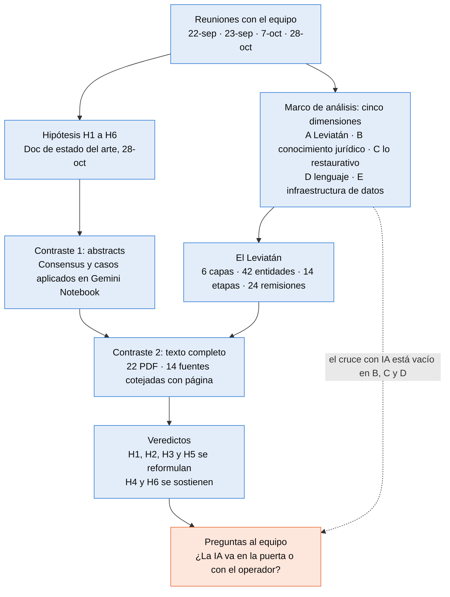
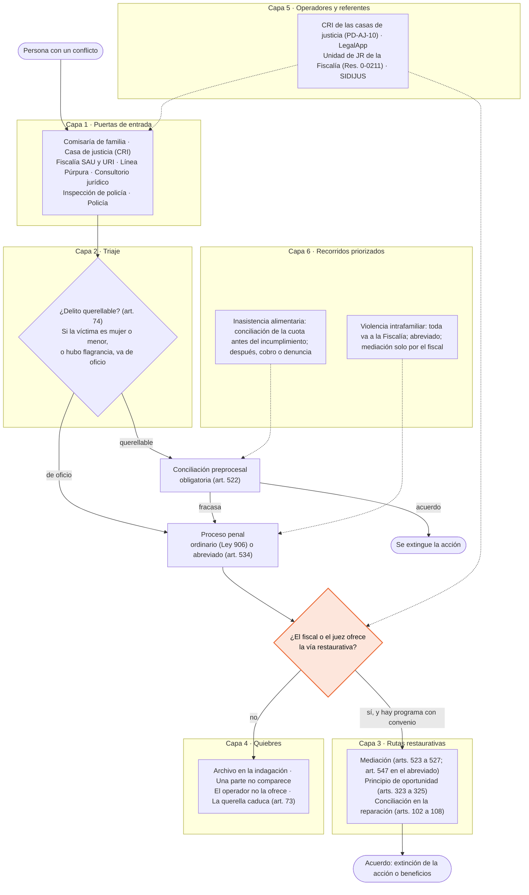
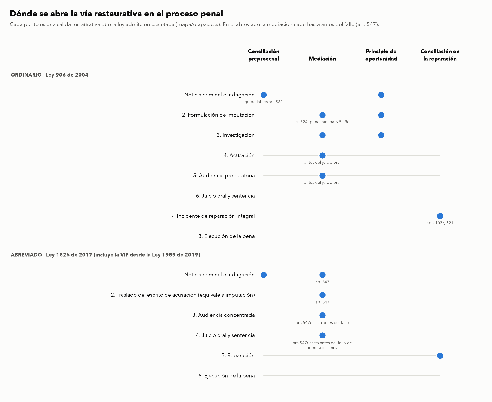
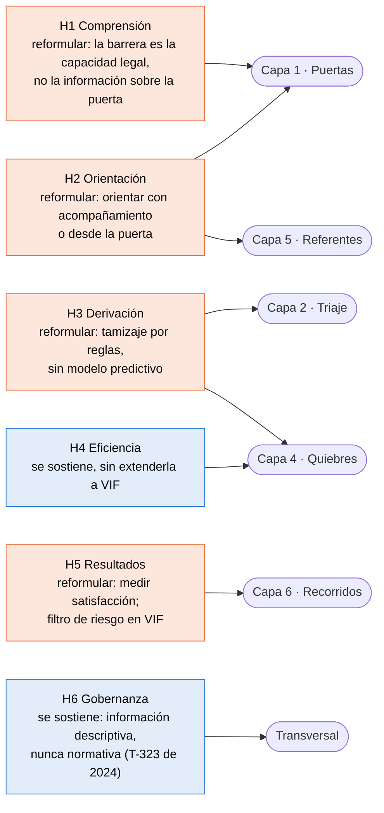

# Justicia restaurativa en Bogotá: el Leviatán y el estado del arte

Investigación de apoyo a la PoC 21871 «Tecnología para fortalecer el acceso y la restauración en la justicia», del programa Atenea (Inteligencia Artificial Urbana para Bogotá). La ejecuta la Alianza CAOBA con el equipo de Ciencias Jurídicas de la Pontificia Universidad Javeriana, entre el 1 de octubre de 2026 y el 30 de enero de 2027.

La pregunta que ordena el trabajo es **en qué punto de cada recorrido por el sistema de justicia se ofrece la vía restaurativa, quién decide ofrecerla y qué pasa cuando no se ofrece**. Para responderla se dibuja el ecosistema completo (el Leviatán) y se contrastan con la literatura las seis hipótesis del equipo sobre dónde puede intervenir un agente de IA.

**Estado al 2 de noviembre de 2026.** El Leviatán tiene 42 entidades, 14 etapas procesales y 24 remisiones con norma y cita. Las hipótesis H1 a H6 se contrastaron primero con abstracts y después con 22 textos completos. Cuatro de las seis hipótesis hay que reformularlas, y eso se lleva al equipo en la próxima sesión.

## Dónde estamos

1. **En los delitos, casi nadie deja de actuar por no saber a dónde ir.** Entre quienes no hicieron nada ante un delito, el 4% no supo a dónde acudir. En cambio, el 36% creyó que no era importante, el 21% no confiaba en las autoridades y el 20% no tenía pruebas (PNUD y DNP, 2023, *Cuaderno 3*, gráfico 31, p. 53; la asignación de columnas del gráfico es lectura propia). Por eso un agente que solo indique la puerta ataca la barrera menor, y H1 se reformula.
2. **La orientación digital rinde cuando alguien acompaña.** Con ayuda, al 80% de los usuarios el Solution Explorer de Columbia Británica le resolvió todo o casi todo; sin ayuda, al 17% (Sykes et al., 2020, p. 173, n = 49).
3. **La vía restaurativa en lo penal tiene una sola llave.** La comisaría remite toda la violencia intrafamiliar a la Fiscalía (Ley 2126 de 2021, art. 17, par. 3; Circular 089 de 2023) [verificado], y solo el fiscal o el juez pueden remitir a mediación, y únicamente a un programa con convenio (Res. FGN 0383 de 2022, art. 14) [verificado]. En consecuencia, la bifurcación restaurativa depende de que el operador la ofrezca.
4. **Quien ofrece la vía decide por intuición.** Los estudios con policías de Países Bajos y Dinamarca describen la derivación como una decisión basada en el instinto o como una «formalidad blanda» que se olvida (Hoekstra, 2022; Sandbye, 2024; Rasmussen, 2020). Por eso H3 pasa de un modelo predictivo a un tamizaje por reglas que deje visible al elegible.
5. **Lo robusto de lo restaurativo es la satisfacción de la víctima.** La reincidencia baja un 17% (OR 0,83 [0,72; 0,95]), pero el efecto desaparece en los ensayos aleatorios, mientras que la satisfacción tiene d = 0,63 (Fulham et al., 2023, tabla 2, pp. 1493–1494). En violencia intrafamiliar ningún estudio midió el bienestar de la víctima (Kettrey et al., 2024).
6. **Bogotá ya formalizó su Leviatán.** El Decreto 225 de 2026 crea el Sistema Distrital de Justicia, con enfoque restaurativo y con un mandato de interoperabilidad de los sistemas de información (art. 174.10) [verificado]. Nadie lo había mencionado en las reuniones.

## El camino de la investigación



## El mapa del Leviatán

La analogía viene de la reunión del 28-oct: el sistema de salud tiene puertas, triaje, niveles de atención y salidas, y la justicia también. El diagrama sigue a una persona con un conflicto a través de las seis capas. En naranja está el punto donde se decide la vía restaurativa.



El detalle de cada capa, con norma y grado de verificación, está en [`leviatan.md`](leviatan.md). La bajada a entidades, normas y etapas está en [`leviatan-estructura.md`](leviatan-estructura.md).

### Quién manda el caso a quién

Las 24 remisiones de [`mapa/remisiones.csv`](mapa/remisiones.csv), con las entidades ordenadas por bloque del Estado. La línea naranja es la única entrada formal a la mediación penal.


Por ruta, la red cambia de forma: en violencia intrafamiliar todo converge en el fiscal, en las casas de justicia el CRI reparte a ocho entidades y en alimentos hay dos caminos paralelos (cobrar ante el juez de familia o denunciar).


### Dónde se abre la vía restaurativa en el proceso penal



## Las hipótesis

Cada hipótesis se prueba en una capa del Leviatán. El color indica el veredicto después de leer los textos completos.



| | Veredicto | Fuente principal |
|---|---|---|
| H1 Comprensión | Reformular | PNUD (2023), p. 53; Pleasence (2003), p. 24; Hilbink (2021) |
| H2 Orientación | Reformular | Sykes (2020), p. 173; Chaara (2022); Guarin (2023) |
| H3 Derivación | Reformular | Hoekstra (2022); Sandbye (2024); Rasmussen (2020); Weinrath (2022), solo abstract |
| H4 Eficiencia | Se sostiene con un límite | Charkoudian (2021), pp. 19 y 25; Lounkaew (2026) |
| H5 Resultados | Reformular | Fulham (2023), pp. 1493–1494; Strang (2013); Kettrey (2024); Campos (2021) |
| H6 Gobernanza | Se sostiene | Magesh (2024); Dahl (2024); T-323 de 2024, considerandos 350 a 357 |

El contraste completo, hipótesis por hipótesis, está en [`estado-del-arte/contraste-hipotesis.md`](estado-del-arte/contraste-hipotesis.md).

## Cobertura de la evidencia

| Nivel | Cuántas | Qué significa |
|---|---|---|
| Texto completo con cita cotejada en el PDF | 14 | La cita y la página se revisaron contra el PDF; llevan la marca [PDF] |
| Texto completo descargado | 22 | 21 pasaron por el cuaderno de lectura de Gemini; Westmarland (2018) se agregó después desde el repositorio de Durham. Lo que no lleva [PDF] no se cotejó |
| Solo abstract | Weinrath (2022), Magesh (2024), Dahl (2024), Wallat (2025) y otras | Sirven para ubicar el estudio; no se citan como hallazgo |
| Normas y documentos oficiales abiertos | Ley 2126 de 2021, Ley 1959 de 2019, Res. 0383 de 2022, Res. 0-0211 de 2025, Res. 2638 de 2016, Decreto 225 de 2026 | Llevan la marca [verificado] o [abierto] |

**Lectura asistida.** La lectura de las fuentes la hicieron herramientas de IA. Gemini Notebook buscó, importó y extrajo los textos, y Claude (Anthropic) cotejó contra el PDF cada cita marcada [PDF], con su página. Felipe Soto definió las preguntas, eligió las fuentes y revisó las conclusiones. Gemini cometió errores que se corrigieron al cotejar: confundió el ensayo de Mills (2019) en Utah con el de Nogales y atribuyó a Fulham (2023) un efecto que el texto no respalda. Por eso cada cifra lleva su marca.

**Grados de verificación** que se usan en todos los documentos:

| Marca | Qué quiere decir |
|---|---|
| [verificado] o [abierto] | Se abrió y leyó el texto oficial |
| [PDF] | Cita cotejada en el PDF con su página |
| [cita] | Texto literal de una fuente oficial, tal como lo devolvió Gemini, sin abrir el original |
| [abstract] | Resumen que entrega Consensus |
| [secundaria] | Prensa o blog jurídico |
| [sin cita] | Sin respaldo; no se usa hasta verificarlo |

## Próximos pasos

| Qué | Quién | Para cuándo |
|---|---|---|
| Llevar al equipo la reformulación de H1 y decidir si la IA va en la puerta o con el operador | Felipe, con Efraín, Luis Gabriel y Jorge | Próxima sesión |
| Validar con Lorena la mediación en VIF y el límite de género, la vigencia de la Res. 0383 frente a la 0-0211 y la inasistencia alimentaria como primera iteración | Felipe y Lorena | Próxima sesión |
| Buscar literatura para el cruce con IA en las dimensiones B, C y D; empezar por Yadav (2026) y Sobrino (2026), sin leer | Felipe | Sprint S3 (hasta el 15-nov) |
| Levantar las remisiones de vuelta, las de la Defensoría y la Personería, y los plazos | Felipe | Sprint S3 |
| Contar los despachos en Bogotá (CSJ y Fiscalía) y conseguir el PD-AJ-10 y el MA-AJ-08 completos | Sin dueño | Sin fecha |
| Verificar en la fuente primaria las cifras [sin cita]: el 93% de la CEJ, la ENJ 2022 y el piloto de mediación de la Fiscalía | Felipe | Antes de citarlas |
| Conseguir Weinrath (2022) por préstamo interbibliotecario o escribiéndole al autor | Felipe | Sin fecha |
| Pasar el contraste al Doc de estado del arte | Felipe, con visto bueno del equipo | Después de la sesión |
| Dibujar con el equipo el mapa completo y volver a reunirse con Jorge | Luis Gabriel, Felipe y Efraín | Sin fecha |

## Cómo está organizado

| Carpeta o archivo | Qué tiene |
|---|---|
| [`marco-de-analisis.md`](marco-de-analisis.md) | Las cinco dimensiones del equipo, lo levantado leído desde ellas y el cruce con IA |
| [`leviatan.md`](leviatan.md) | Las seis capas, las consultas de búsqueda y las fuentes con su criterio |
| [`leviatan-estructura.md`](leviatan-estructura.md) | Entidades, normas, etapas del proceso penal y remisiones |
| [`mapa/`](mapa/) | Los CSV del Leviatán, el script de grafos y las figuras |
| [`estado-del-arte/`](estado-del-arte/) | Contraste de H1 a H6, lectura de Gemini, hilo de Consensus y prompt de lectura |

Los PDF de terceros (`estado-del-arte/pdfs/`) no se versionan, y tampoco las notas de reuniones ni los documentos internos de CAOBA.

### Regenerar los grafos

```bash
uv run mapa/grafos.py
```

El script declara sus dependencias, así que `uv` arma su propio entorno. Antes de dibujar, valida que cada id de `remisiones.csv` y de `depende_de` exista en `entidades.csv`. En `origen` y `destino` una fila puede traer varios ids separados por `|`; el script la expande en varias flechas, porque cada fila corresponde a una norma.

## Equipo

| Persona | Rol |
|---|---|
| Lorena Vega | Investigadora principal, Ciencias Jurídicas (justicia transicional y restaurativa) |
| Edgar Efraín Castrillón | Director de la Alianza CAOBA, gerente del proyecto |
| Luis Gabriel Moreno | Vinculación técnica, NLP |
| Fabián Orlando Ramírez | Equipo técnico CAOBA |
| Felipe Soto | Apoyo técnico: estado del arte, diseño experimental y desarrollo |
| Jorge Salcedo | JEP, consultado a título personal |

## Herramientas y acceso

Los cuadernos de Gemini Notebook y el Doc de estado del arte son privados, así que los enlaces de los documentos solo abren con acceso del equipo.

- **Consensus**: búsqueda académica.
- **Gemini Notebook**: cuadernos del Leviatán (0d8f078d), de la estructura jurídica (9f63dd7b), de las remisiones (ced95367), de los casos aplicados (66294132) y de la lectura de fuentes clave (e977fd05).
- **Granola**: notas de las reuniones.
