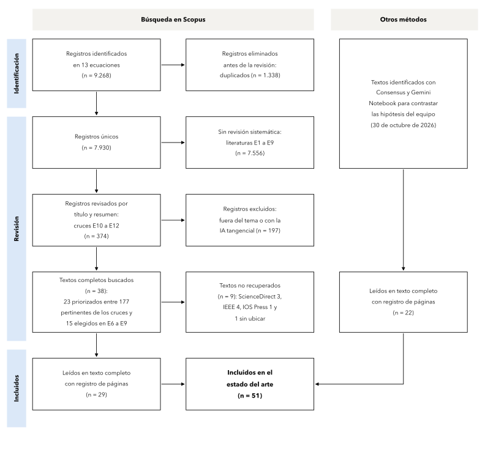
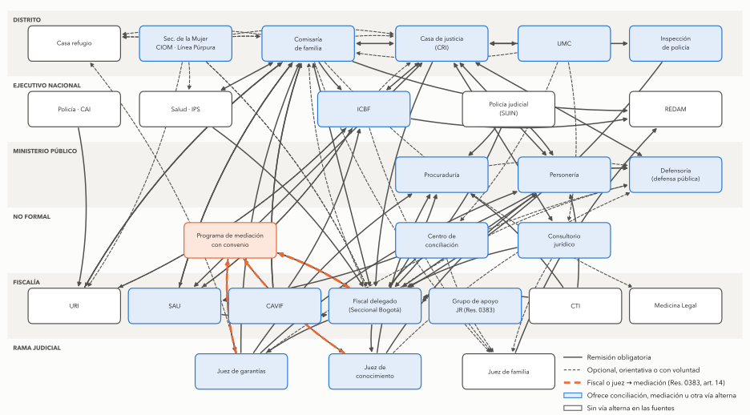
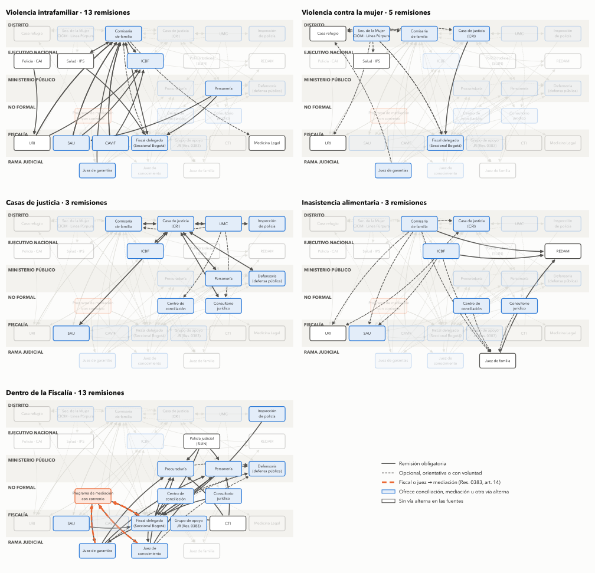

# Justicia restaurativa e inteligencia artificial en Bogotá

Estado del arte y mapa del Leviatán · Proyecto 21871 «Tecnología para fortalecer el acceso y la restauración en la justicia» · Alianza CAOBA y Pontificia Universidad Javeriana · Versión 1, noviembre de 2026

> **Versión 1, en proceso de validación.** Este documento reúne lo levantado durante el primer mes del proyecto y todavía no ha sido revisado por el equipo jurídico ni por los expertos consultados. Las hipótesis, el mapa del Leviatán y las conclusiones sobre la literatura son una propuesta de trabajo para discutir, no resultados cerrados. La sección 8 detalla qué falta validar y con quién.

## Resumen

El proyecto 21871, del programa Atenea, explora cómo un agente de inteligencia artificial puede ayudar a que las personas en Bogotá lleguen a la justicia y, cuando corresponde, a la vía restaurativa. Para situarlo se revisaron tres literaturas que hoy se estudian por separado: el acceso a la justicia, la justicia restaurativa en lo penal y la inteligencia artificial aplicada al derecho, a las que se suma el lenguaje judicial sobre las víctimas. Trece ecuaciones en Scopus reunieron 7.930 documentos distintos, de los cuales 51 se leyeron en texto completo con registro de páginas para contrastar las hipótesis del equipo. Cada literatura tiene un cuerpo propio, pero casi no se citan entre sí: entre la justicia restaurativa y la inteligencia artificial solo el 0,03% de los pares de documentos comparte una referencia, y de los 57 documentos que las cruzan apenas cuatro aplican la IA a un proceso restaurativo penal, ninguno para orientar a la ciudadanía ni para derivar casos. En paralelo se empezó a dibujar el Leviatán, como llamó Jorge Salcedo al Estado y su sistema de justicia, con 42 entidades, 14 etapas procesales y 38 remisiones con su norma, lo que muestra que en lo penal la vía restaurativa solo se abre cuando un fiscal o un juez la ofrece.

## Contenido

1. [Desafío planteado](#1-desafío-planteado)
2. [Universo relevante](#2-universo-relevante)
3. [Cuánto se leen entre sí las literaturas](#3-cuánto-se-leen-entre-sí-las-literaturas)
4. [Cómo se organiza cada literatura](#4-cómo-se-organiza-cada-literatura)
5. [Lo que sostiene la lectura completa](#5-lo-que-sostiene-la-lectura-completa)
6. [Vacío en la literatura](#6-vacío-en-la-literatura)
7. [El Leviatán: qué es y cómo se ve](#7-el-leviatán-qué-es-y-cómo-se-ve)
8. [Lo que falta validar](#8-lo-que-falta-validar)
9. [Organización del repositorio](#9-organización-del-repositorio)
10. [Referencias](#10-referencias)

## 1. Desafío planteado

El proyecto partió de un supuesto que comparte buena parte del sector: la gente no llega a la justicia porque no sabe a qué entidad acudir. Sin embargo, los datos de Colombia matizan ese supuesto. Según el PNUD y el DNP (2023), en el 44% de los problemas justiciables las personas no hicieron nada para resolverlos, y en el caso de los delitos solo el 4% de quienes no actuaron dijo no saber a dónde ir, mientras que el 36% creyó que no valía la pena, el 21% no confiaba en las autoridades y el 20% no tenía pruebas (la lectura de las columnas del gráfico del informe es propia). En otras palabras, la barrera principal en lo penal no está en la puerta, sino en lo que la persona espera encontrar detrás de ella.

Por otra parte, la vía restaurativa no depende solo de la ciudadanía. En Colombia la mediación penal es voluntaria y requiere que un operador la ofrezca, de modo que un agente que oriente a las personas tiene que entender también dónde se decide la ruta de un caso y quién la decide. A eso se suma que la inteligencia artificial todavía se equivoca con frecuencia cuando informa sobre derecho. Los modelos de lenguaje generales dieron respuestas falsas en el 58% a 88% de las preguntas verificables sobre fallos federales de Estados Unidos (Dahl y colegas, 2024), e incluso las herramientas comerciales de investigación jurídica, que consultan bases de datos antes de responder, lo hicieron en el 17% a 33% de las consultas (Magesh y colegas, 2025), lo que obliga a preguntarse qué puede decir un agente sin poner en riesgo a quien lo consulta. Es por esto que el desafío es diseñar un agente que oriente sobre el sistema de justicia de Bogotá con información fiable, que haga visible la vía restaurativa donde la ley la permite y que reconozca sus límites, en particular en la violencia intrafamiliar. Para ello hay que responder por qué las personas no llegan, dónde y quién decide la vía restaurativa, y qué tan fiable es hoy la IA que informa sobre derecho.

## 2. Universo relevante

La revisión se hizo en tres pasos. Primero, Consensus AI sirvió para contrastar las seis hipótesis del equipo con la literatura e identificar los trabajos que las respaldan o las discuten. Después, trece ecuaciones en Scopus, numeradas de E1 a E13, permitieron ampliar la búsqueda de forma sistemática y comprobar que se recuperaran artículos conocidos de antemano. Por último, los 374 documentos de los cruces E10 a E12 se revisaron por título y resumen con criterios explícitos, y los textos más cercanos a las preguntas del proyecto se leyeron completos: 22 en una primera ronda, centrada en las hipótesis, y 29 en una segunda, que cubrió la IA jurídica, los cruces y el lenguaje judicial. La Figura 1 presenta ese recorrido con el diagrama de flujo PRISMA 2020 (Page y colegas, 2021), que es el estándar para informar cómo se identifican, revisan e incluyen los estudios de una revisión.

**Figura 1.** Diagrama de flujo PRISMA 2020 de la búsqueda



*Nota:* E1 a E13 son las ecuaciones de búsqueda en Scopus, en título, resumen y palabras clave, sin filtro de años, corridas el 2 de noviembre de 2026. La revisión por título y resumen cubrió solo los cruces entre literaturas; en las literaturas E1 a E9 los textos se eligieron por pertinencia, de modo que esta no es una revisión sistemática completa. Los 22 textos de la columna derecha provienen de la búsqueda con Consensus previa a las ecuaciones. Las ecuaciones completas y la prueba de sensibilidad están en [`protocolo.md`](estado-del-arte/busqueda/protocolo.md). *Fuente:* Elaboración propia.

Las trece ecuaciones devolvieron 9.268 resultados, que corresponden a 7.930 documentos distintos. La Tabla 1 resume qué pregunta cada ecuación y cuántos documentos trajo en la segunda corrida, que es la definitiva. Entre la primera y la segunda corrida se amplió el bloque de rutas de E1, que perdía dos artículos conocidos, y se quitaron dos términos genéricos de las ecuaciones de IA, que traían documentos ajenos al derecho.

**Tabla 1.** Ecuaciones de búsqueda y documentos por ecuación

| Ecuación | Pregunta | Documentos |
|---|---|---:|
| E1 | ¿Por qué la gente llega o no al sistema de justicia, y quién la orienta? | 1.814 |
| E2 | ¿Qué se sabe de las necesidades jurídicas en América Latina? | 806 |
| E3 | ¿Quién deriva a la vía restaurativa, con qué criterio y en qué etapa? | 789 |
| E4 | ¿Cabe la vía restaurativa en la violencia intrafamiliar? | 288 |
| E5 | ¿Qué efectos tiene, según los estudios de mejor diseño? | 52 |
| E6 | ¿Cómo se usa la IA para informar y orientar a la ciudadanía en asuntos jurídicos? | 2.667 |
| E7 | ¿Qué tan fiable es la IA en preguntas jurídicas? | 625 |
| E8 | ¿Cómo se representa el conocimiento jurídico para que una máquina lo use? | 1.465 |
| E9 | ¿Qué se ha medido del lenguaje judicial sobre las víctimas? | 374 |
| E10 | Cruce: IA y justicia restaurativa | 57 |
| E11 | Cruce: IA para orientar y derivar en el acceso a la justicia | 248 |
| E12 | Cruce: la vía restaurativa vista desde el acceso a la justicia | 71 |
| E13 | Cruce completo: IA, justicia restaurativa y acceso o derivación | 12 |

*Fuente:* Elaboración propia con datos de Scopus.

La lectura fue asistida por inteligencia artificial. Gemini Notebook extrajo los textos completos y Claude (Anthropic) cotejó contra cada PDF las citas que se usan aquí, con su página, además de revisar los cruces por título y resumen. Felipe Soto definió las preguntas y las tres literaturas. La primera ronda de lectura cubrió el acceso a la justicia y la justicia restaurativa, y la segunda agregó la IA jurídica, los cruces y el lenguaje judicial. Las fichas de cada texto, con su diseño, sus hallazgos citados con página y lo que cambia en este documento, están en [`estado-del-arte/lectura/`](estado-del-arte/lectura/). Cuando una afirmación sale solo del resumen, el texto lo dice.

## 3. Cuánto se leen entre sí las literaturas

Para saber si estas literaturas dialogan, se midió en cada par de documentos si comparten al menos una referencia citada, tanto dentro de cada literatura como entre ellas. Es la misma medida del mapa del campo de la tesis del autor, y su ventaja es que no depende de cómo se nombra cada tema, sino de a quién se cita. La Tabla 2 presenta el resultado.

**Tabla 2.** Pares de documentos que comparten al menos una referencia

| Grupos comparados | Comparten | Total de pares | % |
|---|---:|---:|---:|
| *Dentro de cada literatura* | | | |
| Acceso a la justicia (2.274 documentos) | 12.748 | 2.584.401 | 0,49% |
| Justicia restaurativa (1.033) | 41.682 | 533.028 | 7,82% |
| IA y derecho (3.877) | 166.051 | 7.513.626 | 2,21% |
| Lenguaje judicial (372) | 2.604 | 69.006 | 3,77% |
| *Entre literaturas* | | | |
| Lenguaje judicial × restaurativa | 3.518 | 384.276 | 0,92% |
| Acceso × restaurativa | 5.255 | 2.349.042 | 0,22% |
| Acceso × IA | 4.435 | 8.816.298 | 0,05% |
| Lenguaje judicial × IA | 756 | 1.442.244 | 0,05% |
| **Restaurativa × IA** | **1.032** | **4.004.941** | **0,03%** |

*Nota:* las referencias se comparan por sus primeros 60 caracteres normalizados. El cálculo está en [`corpus.py`](estado-del-arte/busqueda/corpus.py) y su salida completa en [`conexion.txt`](estado-del-arte/busqueda/conexion.txt). *Fuente:* Elaboración propia con datos de Scopus.

La justicia restaurativa es la literatura más cohesionada, ya que casi el 8% de sus pares de documentos comparte alguna referencia, mientras que el acceso a la justicia es la más dispersa, con menos del 0,5%. Entre literaturas, en cambio, los vínculos caen a fracciones mínimas, y el más débil es justamente el que interesa al proyecto: entre la justicia restaurativa y la inteligencia artificial, solo 3 de cada 10.000 pares comparten una referencia. Además, lo poco que comparten es método o teoría general y no hallazgos, porque las referencias comunes más frecuentes son manuales de análisis cualitativo (Braun y Clarke), de revisiones sistemáticas (PRISMA) y de potencia estadística (Cohen), junto con clásicos como Rawls, Hart y Tyler.

## 4. Cómo se organiza cada literatura

Las figuras de esta sección se construyeron con bibliometrix sobre los 7.930 documentos. La cocitación muestra qué referencias se citan juntas y, por lo tanto, la base intelectual de cada campo; las palabras clave muestran de qué hablan los documentos; y el mapa temático ubica cada tema según cuánto se conecta con los demás y cuánto se trabaja por dentro.

**Figura 2.** Cocitación de las 40 referencias más citadas del corpus


*Nota:* dos referencias se unen cuando un mismo documento las cita juntas; el tamaño del nodo es el número de cocitaciones y los grupos salen de la agrupación walktrap. Naranja, el canon de la justicia restaurativa; violeta, la crítica feminista a su uso en la violencia de género; aguamarina, la IA jurídica; azul, la conciencia jurídica; en gris, referencias que no forman grupo. *Fuente:* Elaboración propia con datos de Scopus.

La Figura 2 muestra dos islas. Abajo está la justicia restaurativa, que se divide en dos grupos muy unidos entre sí: el canon, con Braithwaite (1989), Zehr (1990), Strang (2002) y McCold (1998), al que se suma la justicia procedimental de Tyler (1990), y la crítica feminista a su uso en la violencia de género, con Stubbs, Daly, Coker y Acorn. Arriba, lejos, está la IA jurídica, que cita modelos de lenguaje adaptados al derecho (Chalkidis, Xiao, Beltagy), el manual de razonamiento jurídico computacional de Ashley (2017), el informe técnico de GPT-4 y el reglamento europeo de IA. Entre ambas queda sola la conciencia jurídica de Ewick y Silbey (1998), y las líneas que las cruzan son pocas y tenues. Cabe notar que la literatura de acceso a la justicia, aunque aporta 2.274 documentos, no alcanza a formar un grupo propio entre las referencias más citadas, lo que coincide con su baja cohesión en la Tabla 2.

**Figura 3.** Coocurrencia de las 35 palabras clave de autor más frecuentes


*Nota:* dos palabras se unen cuando aparecen en el mismo documento, con al menos dos coocurrencias por enlace. Azul, acceso a la justicia y mecanismos alternativos; naranja, justicia restaurativa; violeta, violencia intrafamiliar; gris oscuro, IA en general; aguamarina, modelos de lenguaje y recuperación de información. *Fuente:* Elaboración propia con datos de Scopus.

En las palabras clave la separación se repite, aunque con matices. El acceso a la justicia se agrupa con la mediación, la resolución alternativa y en línea de disputas y la asistencia legal, y desde ahí se conecta con la IA. La IA, a su vez, se divide en un grupo general (ética, chatbots, IA generativa) y uno técnico (modelos de lenguaje, generación aumentada por recuperación, grafos de conocimiento). En cambio, «restorative justice» y «domestic violence» quedan cada una sola en un borde de la red, unidas al resto por enlaces débiles, lo que indica que la justicia restaurativa casi no comparte vocabulario con la IA ni con el acceso a la justicia.

**Figura 4.** Mapa temático según centralidad y densidad


*Nota:* el eje horizontal es la centralidad, es decir, cuánto se conecta el tema con los demás, y el vertical es la densidad, es decir, cuánto se trabaja por dentro. Arriba a la izquierda están los temas de nicho, arriba a la derecha los motores, abajo a la derecha los básicos y abajo a la izquierda los emergentes o en declive. *Fuente:* Elaboración propia con datos de Scopus.

El mapa temático resume lo anterior. La justicia restaurativa es un tema de nicho, desarrollado por dentro pero desconectado del resto. La inteligencia artificial es un tema motor y los modelos de lenguaje uno básico, que conecta con todo pero se trabaja poco por dentro. El acceso a la justicia, por su parte, aparece con baja centralidad y baja densidad, lo que sugiere un campo amplio que no se articula alrededor de un vocabulario común. El agente que propone el proyecto trabaja precisamente entre el nicho restaurativo y el tema básico de los modelos de lenguaje.

## 5. Lo que sostiene la lectura completa

Los 51 textos leídos completos permitieron contrastar las hipótesis del equipo con los datos de cada estudio y no con sus resúmenes. Lo que sostienen se ordena en seis movimientos. El contraste detallado, hipótesis por hipótesis, está en [`contraste-hipotesis.md`](estado-del-arte/contraste-hipotesis.md).

### 5.1 La barrera no está en la puerta

La literatura sobre necesidades jurídicas coincide en que las personas dejan de actuar menos por no saber a dónde ir que por no reconocer su problema como jurídico o por creer que nada se puede hacer. En Inglaterra y Gales, el costo apareció en menos del 5% de las razones para no actuar, y en la violencia doméstica el 32% no actuó porque creía que no se podía hacer nada (Pleasence y colegas, 2003). En Estados Unidos, entre las razones más importantes están no ver el problema como legal y creer que ya se hace lo posible, mientras que el costo explica solo el 17% de los problemas sin ayuda (Sandefur, 2016). En Colombia, el dato del PNUD y el DNP (2023) va en la misma dirección, y Hilbink y colegas (2022) muestran, con grupos focales en Medellín y Santiago, que la desconfianza tampoco explica por sí sola la decisión de acudir, porque pesan más las expectativas y la capacidad de agencia legal. Guarin y colegas (2024) agregan que, entre las madres custodias de Colombia, las más vulnerables son las que más problemas de familia tienen y las que menos buscan ayuda institucional. Por lo tanto, un agente que solo indique la puerta atacaría la barrera menor, y lo que necesita es explicar qué se puede lograr y qué hace falta para lograrlo. Sin embargo, la vía restaurativa es una excepción, porque ahí la puerta tampoco la conocen quienes deben derivar. En Ghana, de los 12 paneles que la ley creó para mediar casos de menores en los 16 distritos visitados, solo uno funcionaba, porque nadie les remitía casos y los propios funcionarios no sabían que existían (Ame y colegas, 2020). De ahí que el agente deba hacer visible la vía también ante el orientador.

### 5.2 Orientar rinde cuando alguien acompaña

Las herramientas de orientación funcionan mejor con una persona al lado. En el tribunal en línea de Columbia Británica, al 80% de quienes tuvieron ayuda el sistema les resolvió todo o casi todo, frente al 17% de quienes lo usaron solos (Sykes y colegas, 2020). En Burundi, la asistencia legal de asesores locales aumentó el uso de los tribunales, pero no cambió el uso de los mecanismos alternativos (Chaara y colegas, 2022). En la IA jurídica no hay estudios que comparen el rendimiento con y sin acompañamiento, pero los sistemas que llegaron a operar dejan a una persona al final del recorrido, y en JusticeBot, usado sin orientador, la mitad de quienes respondieron la encuesta no encontró su ruta en el menú (Westermann y Benyekhlef, 2023). De ahí que orientar no lleve por sí solo a la vía restaurativa, y que el agente rinda más desde una puerta con un orientador, como el Centro de Recepción e Información de las casas de justicia, que solo frente al ciudadano.

### 5.3 Quien deriva decide la vía restaurativa

En los países donde se ha estudiado, la derivación a la vía restaurativa depende del juicio del operador. En Países Bajos, 33 entrevistas mostraron que los policías ofrecen la vía restaurativa sin protocolo y por intuición, y sus relatos dejan ver que también pesa su juicio moral sobre la víctima y el ofensor (Hoekstra, 2022). En un distrito de Dinamarca, los policías ven el aviso de mediación como una formalidad blanda, que se olvida o se posterga, y muchos conocen poco el programa (Sandbye y colegas, 2024). Además, según entrevistas con coordinadores de cinco distritos daneses, que a las partes se les informe de la mediación varía según el distrito y el policía, y en la mayoría de los casos no se les informa por desconocimiento (Rasmussen, 2020). Son estudios cualitativos y exploratorios, pero coinciden en el mecanismo. Además, la discrecionalidad no solo restringe la vía, porque en Finlandia algunos fiscales derivan a mediación pese a la negativa inicial de las partes y algunos funcionarios cierran el caso antes de que se cumpla el acuerdo (Jauhiainen, 2025; Jauhiainen y Obstbaum, 2026, que comparten la misma base de entrevistas). En Colombia ocurre algo análogo, porque solo el fiscal o el juez pueden remitir un caso penal a mediación, y únicamente a un programa con convenio (Resolución 0383 de 2022 de la Fiscalía, artículo 14). En consecuencia, la elegibilidad se puede expresar como reglas que hagan visible el caso elegible, sin necesidad de un modelo predictivo, siempre que esas reglas lleguen al operador cuando decide, porque en Finlandia las pautas escritas existían pero no se usaban (Jauhiainen, 2025).

Desde el lado de quien busca la vía, el cruce E12 reúne 71 documentos, de los cuales 17 son pertinentes. Entre ellos, una encuesta checa a 3.577 personas encontró que solo el 31% identificaba qué es la mediación, en general y no la penal, y estaba seguro de su respuesta, que el desconocimiento era mayor entre quienes tenían menos educación e ingresos o vivían en municipios pequeños, y que menos de 1 de cada 10 sabía cómo encontrar un mediador. Además, solo el 1,6% había pasado por una mediación penal, y la mayoría llegó porque una autoridad o el servicio de mediación le informó (Holá y colegas, 2026). En Colombia, un estudio sobre los consultorios jurídicos de Cartagena afirma que 3 de 10 estaban acreditados para mediar y que atendieron unos 120 casos en 2024, aunque la cifra viene de registros internos de los mismos centros, el artículo da otras versiones del universo y concluye que la mediación penal en los consultorios es «prácticamente inexistente o, en el mejor de los casos, incipiente y no documentada» (Beetar Bechara y Martínez Montenegro, 2026). La revisión está en [`revision-e12.csv`](estado-del-arte/busqueda/revision-e12.csv).

### 5.4 Lo robusto es la satisfacción de la víctima

Los metaanálisis coinciden en que la justicia restaurativa mejora la experiencia de la víctima, pero no en cuánto reduce la reincidencia. Fulham y colegas (2025) encontraron una reducción de la reincidencia general cercana al 17%, que deja de ser significativa en la reincidencia violenta y en los ensayos aleatorios, mientras que el efecto sobre la satisfacción de la víctima es mayor (d = 0,63). La revisión Campbell de Strang y colegas (2013), con diez ensayos aleatorios, halló una reducción pequeña de la reincidencia a dos años (d = 0,155), algo mayor en delitos violentos (d = 0,20) y prácticamente nula en delitos contra la propiedad, aunque la diferencia entre ambos grupos no fue significativa, y la satisfacción de las víctimas fue mayor en todos los ensayos que la midieron. Por su parte, Islam y colegas (2023) sí encontraron un efecto significativo en los delitos violentos, a diferencia de Fulham. Por eso la medida más defendible para un piloto es la satisfacción y la justicia procedimental de quienes pasan por el proceso.

### 5.5 En la violencia intrafamiliar la evidencia no alcanza

La violencia intrafamiliar es el límite más claro. La revisión de Kettrey y Reynolds (2026) encontró solo cuatro estudios elegibles en violencia sexual y doméstica, con un efecto que no es significativo en los ensayos aleatorios y sin ninguna medición del bienestar de la víctima. Además, la práctica documentada es preocupante: en Inglaterra la policía usó el lenguaje restaurativo para cerrar casos sin más acción (Westmarland y colegas, 2018), en Brasil la invitación al círculo operó como una citación y las mujeres lo vivieron como terapia o reconciliación (De Campos y De Oliveira, 2021), y la revisión de Hudson y Berger (2026) identifica el desequilibrio de poder y la retraumatización como riesgos principales. En Java Central, entrevistas con operadores muestran que la policía media después de explicar a la víctima las consecuencias del juicio, que da por exitosa la mediación cuando el caso no llega al tribunal y que fuera del tribunal no se exige formación a quien media (Sukendar y colegas, 2023). En la norma colombiana el límite es condicional y no absoluto. Ninguna ley excluye la violencia intrafamiliar de la mediación, que desde la Ley 1959 de 2019 se tramita por el procedimiento abreviado, donde la mediación puede extinguir la acción hasta antes del fallo (Ley 906 de 2004, art. 547). El manual de justicia restaurativa de la Fiscalía la admite, pero no si la valoración del riesgo de la víctima es grave o extrema, y exige que las reuniones previas se hagan por separado para no confrontarla con el agresor (Resolución 0383 de 2022, art. 12). En cambio, la Directiva 0001 de 2021 de la Fiscalía la declara no conciliable ni desistible, y falta saber si sigue vigente; además, la Resolución 0-0211 de 2025, que creó la Unidad de Justicia Restaurativa, no derogó expresamente el manual. El detalle está en [`normas-fiscalia-2026-11-02.md`](estado-del-arte/lectura/normas-fiscalia-2026-11-02.md). Fuera de la violencia intrafamiliar, el riesgo para la víctima aparece cuando la reparación depende de lo que el ofensor puede pagar. En Uzbekistán, en 1.249 sentencias por lesiones de tránsito, el 85% de los casos con peatones terminó en reconciliación, en el 97% de los que no se reconciliaron la causa fue el pago y ninguna sentencia registró el monto acordado; con entrevistas y un indicador indirecto de la riqueza del ofensor, los autores concluyen que quienes pueden pagar compran el perdón y que quedan desprotegidas las víctimas sin seguro ni recibos (Shamsidinov y colegas, 2026). Por eso, cuando el agente muestre la vía restaurativa, también debería decir qué se acuerda y qué alternativas tiene la víctima. Esto sugiere que la primera iteración del agente no debería ofrecer mediación en violencia intrafamiliar, y que la inasistencia alimentaria es un caso más seguro para empezar.

### 5.6 La IA jurídica construye mucho y evalúa poco

De los 248 documentos del cruce E11, la revisión por título y resumen dejó 86 que diseñan o evalúan un sistema de IA que orienta, clasifica o deriva a personas que no son abogados, 48 que discuten el tema sin sistema ni datos y 114 fuera del tema. La mitad de los 86 tiene autores en India y casi todos son prototipos presentados en congresos de ingeniería, de modo que, según sus resúmenes, solo 11 se evaluaron con usuarios, 41 únicamente con métricas del modelo y 34 no se evaluaron. Además, 14 tocan lo penal, pero casi siempre para identificar el artículo aplicable del código, y ninguno deriva a una vía alternativa al proceso. La revisión está en [`revision-e11.csv`](estado-del-arte/busqueda/revision-e11.csv).

La lectura completa de los trabajos más cercanos al proyecto precisa ese panorama. Estos trabajos resuelven tres pasos distintos de la puerta de entrada: orientar al lego por rutas construidas con la ley y la jurisprudencia, y traducir su relato a la ruta que le sirve (Westermann y Benyekhlef, 2023; Westermann y colegas, 2023); decidir si califica para un servicio (Steenhuis y Westermann, 2024); y clasificar su problema para asignarle un abogado o referirlo (Mistica y colegas, 2021; Steenhuis, 2025). Sin embargo, incluso los mejores se evalúan con textos reales sin personas usando el sistema, o con casos generados por el propio modelo, y ninguno mide si quien lo usó resolvió su problema. Asimismo, la equidad entre grupos casi no se mide, y el único estudio que la examinó encontró que el clasificador rendía peor con los mayores de 65 años (Mistica y colegas, 2021). Fuera de lo penal sí aparece la vía amistosa, porque JusticeBot incluye el arreglo directo entre los próximos pasos que muestra y el proyecto europeo IDEA diseña un chatbot que oriente hacia la negociación, la mediación o el juicio en despidos, aunque todavía sin resultados (Molinari y Giacalone, 2026). En Colombia hay dos antecedentes, un clasificador de casos del consultorio jurídico de la Universidad Santo Tomás en Bogotá, que todavía no se pudo leer completo, y un prototipo que aplica modelado de temas al relato en texto libre de los casos que atiende la Personería de Medellín, más de 16.000 al año, donde predominan los reclamos de salud contra las EPS. Sin embargo, este último no clasifica ni deriva casos y no informa ninguna evaluación de su modelo (Espinosa y colegas, 2024).

En paralelo, la fiabilidad sigue siendo el problema central. En un banco de 202 consultas preregistradas, las herramientas comerciales de investigación jurídica dieron respuestas falsas o mal respaldadas en el 17% (Lexis+ AI y Ask Practical Law AI) y el 33% (Westlaw) de los casos, frente al 43% de GPT-4, y parte de ese error consiste en citar fuentes reales que no sostienen lo afirmado, lo que es más difícil de detectar que un caso inventado (Magesh y colegas, 2025). Por su parte, los modelos generales aceptaron premisas falsas en preguntas sobre fallos, GPT-4 en el 69% de ellas (Dahl y colegas, 2024), aunque en el banco de Magesh y colegas el mismo GPT-4 y dos de las herramientas a menudo corrigieron la premisa, de modo que la complacencia con el usuario depende del modelo y de la pregunta. Ninguno de los dos estudios observa a personas sin formación jurídica, si bien Dahl y colegas concluyen que el riesgo es mayor para quienes litigan sin abogado.

Sobre qué puede decir un agente, la literatura leída converge en acotar la tarea y declarar sus límites. Las herramientas con tareas jurídicas específicas son más fáciles de evaluar que los chats abiertos (Magesh y colegas, 2025), un chatbot público que solo informa puede fundar sus respuestas en tablas de decisión auditables (Makasi y colegas, 2020), y avisar que se habla con una máquina no garantiza la veracidad de lo que dice, por lo que la respuesta debe señalar su incertidumbre y remitir a la fuente (Wachter y colegas, 2024). En Colombia no hay una ley que regule estos sistemas, y las normas vigentes acotan al agente por tres vías. Primero, lo reservado a los abogados es ejercer la profesión, anunciarse como abogado y litigar (Decreto 196 de 1971, arts. 4, 24 y 25), mientras que la Ley 2113 de 2021 distingue la pedagogía en derechos de la asesoría jurídica (art. 6); ninguna norma define dónde termina orientar y empieza asesorar, de modo que la afirmación de Londoño Villarreal (2025) de que un chatbot debe limitarse a orientar es una lectura prudente, pero no una regla expresa. Segundo, el tratamiento de datos exige autorización explícita para los datos sensibles (Ley 1581 de 2012, art. 6) y, según la Circular Externa 002 de 2024 de la Superintendencia de Industria y Comercio, ponderar el tratamiento, gestionar los riesgos y hacer un estudio de impacto de privacidad cuando sea probable un riesgo alto (numerales I, III y IV). Tercero, la Sentencia T-323 de 2024 y el Acuerdo PCSJA24-12243 de 2024 del Consejo Superior de la Judicatura fijan criterios de verificación, transparencia y control humano que obligan solo a la Rama Judicial, aunque el Acuerdo admite usar la IA para orientar a la ciudadanía siempre que no interprete hechos ni resuelva casos (art. 12.1.b). El detalle, con citas y enlaces, está en [`normas-ia-2026-11-02.md`](estado-del-arte/lectura/normas-ia-2026-11-02.md).

Por último, de los 57 documentos que cruzan IA y justicia restaurativa, solo cuatro aplican la IA a un proceso restaurativo penal. Dos analizan señales no verbales en las mismas 26 mediaciones víctima-ofensor de Cataluña para predecir el acuerdo que reporta el mediador (Ponce-López y colegas, 2013, 2015), y otros dos, que todavía no se han podido leer completos, estudian la IA en la mediación de procesos penales en China (Lu, 2025) y simulan intervenciones restaurativas con agentes (Ali y colegas, 2026). Un quinto trabajo no aplica la IA a un proceso, pero mide lo que tres modelos de lenguaje dirían a quien pregunta por la vía restaurativa en un caso de abuso sexual intrafamiliar: los modelos se mostraron más abiertos a ella que las 469 personas encuestadas, variaron entre sí y uno se negó a responder, por lo que los autores piden derivación profesional (Peleg-Koriat y Asraf, 2026). La revisión está en [`revision-e10.csv`](estado-del-arte/busqueda/revision-e10.csv).

## 6. Vacío en la literatura

La literatura revisada tiene las piezas del proyecto por separado. Por un lado, la literatura de acceso a la justicia explica por qué las personas no llegan y muestra que orientar rinde con acompañamiento, pero no trata la vía restaurativa. Por otro lado, la literatura restaurativa muestra quién decide derivar y dónde están los límites en la violencia intrafamiliar, pero no habla de inteligencia artificial. Por último, la IA jurídica construye asistentes y clasificadores para la puerta de entrada, pero los evalúa con textos y no con personas, casi no mide la equidad entre grupos y, aunque en lo civil y lo laboral apunta al arreglo directo o a la mediación, en lo penal no conecta con las rutas restaurativas. La Figura 5 contrasta lo que cubre cada literatura con lo que el proyecto necesita reunir.

**Figura 5.** Lo que cubre cada literatura frente a lo que el proyecto necesita reunir

| Literatura | Explica por qué la gente no llega | Muestra quién decide la vía restaurativa | Fija límites en violencia intrafamiliar | Orienta con IA fiable | Representa el conocimiento jurídico para una máquina |
|---|:---:|:---:|:---:|:---:|:---:|
| Acceso a la justicia | ✓ | ~ | ✗ | ~ | ✗ |
| Justicia restaurativa | ~ | ✓ | ✓ | ✗ | ✗ |
| IA y derecho | ✗ | ✗ | ✗ | ~ | ~ |
| Lenguaje judicial | ✗ | ✗ | ~ | ✗ | ✗ |
| Cruces entre literaturas | ~ | ✗ | ~ | ~ | ✗ |
| **Este proyecto** | **✓** | **✓** | **✓** | **✓** | **✓** |

✓ lo estudia · ~ lo toca en parte · ✗ no lo estudia

*Evidencia de la búsqueda:* entre la justicia restaurativa y la IA comparte referencias el 0,03% de los pares de documentos; de los 57 documentos que las cruzan, cuatro aplican la IA a un proceso restaurativo penal, ninguno construye un sistema para orientar o derivar, y uno mide cómo presentan la vía restaurativa los modelos generales.

*Nota:* las columnas son lo que el proyecto necesita reunir según las preguntas de la sección 1. En IA y derecho, lo que se representa son sobre todo normas, fallos y argumentos, mientras que las ontologías son escasas y ninguno de los textos leídos representa rutas procedimentales. *Fuente:* Elaboración propia a partir de las secciones 3 a 5.

Además, la literatura sobre el lenguaje judicial describe las fallas que corrige LEIRA, pero no mide su efecto. En 20 sentencias españolas de casación por violencia de género, la violación nunca se nombra al relatar los hechos y la víctima aparece reducida a ese rol, casi sin mención de su resistencia (Mestre-Mestre, 2023). En las sentencias inglesas sobre mujeres que matan, la forma de nombrar a la acusada la sitúa entre la madre y el monstruo (Potts y Weare, 2018), y en el Tribunal Penal Internacional para la ex Yugoslavia la población se nombra de forma genérica y la responsabilidad con términos variables que dejan ambiguo qué se atribuye a cada acusado (Potts y Kjær, 2016). En Australia del Sur, en 7 de los 10 casos de delitos sexuales juveniles que los jueces trataron como sexo consentido entre pares, la víctima había denunciado una violación, y en esos fundamentos el juez puso el acento en la norma infringida y no en el daño a la víctima (Bouhours y Daly, 2007). Ninguno de estos estudios trata Colombia, mide el efecto del lenguaje en las víctimas ni evalúa una herramienta que corrija sentencias.

Queda abierto, entonces, cómo un agente de IA puede orientar a las personas en Bogotá sobre el sistema de justicia con información fiable, hacer visible la vía restaurativa donde la ley la permite y dejarla fuera donde la evidencia no la respalda, apoyando al operador que decide en lugar de reemplazarlo.

## 7. El Leviatán: qué es y cómo se ve

### 7.1 Qué entendemos por Leviatán

El término lo propuso Jorge Salcedo, docente de Filosofía e Historia del Derecho de la Javeriana, en la reunión del 28 de octubre de 2026 con el equipo (comunicación personal). Retomando la imagen de Hobbes, Salcedo llamó Leviatán al Estado, entendido como una máquina hipercompleja de procesos y procedimientos frente a la cual las personas se sienten indefensas cuando quieren reclamar o ejercer sus derechos. Aclaró que no lo llama monstruo porque sea malo, sino porque su complejidad hace que, en un Estado tan burocratizado como el colombiano, no existan rutas claras ni un abecé que le diga al ciudadano a dónde ir. En su lectura, los sistemas de justicia son estructuras con actores, procesos, entradas, salidas y un intermedio, cuyas reglas de juego son el derecho sustancial y el procesal.

De esa definición se desprenden dos decisiones para el mapa. En primer lugar, el Leviatán se dibuja completo y no solo en su parte restaurativa, porque, según Salcedo, la justicia restaurativa no se opone a la retributiva, sino que la complementa y está inmersa en el proceso penal; por eso el mapa traza una línea que muestra dónde aparece lo restaurativo dentro del sistema. En segundo lugar, lo que interesa son las bifurcaciones: el momento en que el operador consulta a las partes si quieren una vía restaurativa, que es voluntaria, y lo que ocurre cuando no la toman, que es la vía tradicional de la cárcel, la multa y el incidente de reparación. Como referente de un Leviatán que se puede recorrer, Salcedo citó las unidades de atención y orientación integral que nacieron de la sentencia T-025 de 2004, que le evitan a la víctima tener que lidiar con el Estado entero. El equipo acordó entonces dibujar ese mapa para identificar los vacíos y los puntos de intervención, con la analogía del sistema de salud y sus niveles de atención.

### 7.2 El recorrido por las seis capas

Siguiendo esa analogía, una persona entra por una puerta, alguien clasifica su caso y esa clasificación abre o cierra rutas. La Figura 6 sigue ese recorrido a través de las seis capas del mapa.

**Figura 6.** Recorrido de una persona por las seis capas del Leviatán


*Nota:* en naranja, el punto donde se decide la vía restaurativa. Los artículos son de la Ley 906 de 2004; el procedimiento abreviado es el de la Ley 1826 de 2017. *Fuente:* Elaboración propia a partir de la Ley 906 de 2004, la Ley 1826 de 2017 y las normas registradas en [`entidades.csv`](mapa/entidades.csv).

### 7.3 Remisiones entre entidades

Una remisión es el envío de un caso de una entidad a otra porque la norma lo obliga o lo permite. Se levantaron 38 remisiones, cada una con su disparador, su plazo, su norma y su grado de verificación, que la Tabla 3 resume por ruta.

**Tabla 3.** Remisiones levantadas por ruta

| Ruta | Remisiones | Obligatorias | Verificadas en la norma | Remisión que condiciona la vía restaurativa |
|---|---:|---:|---:|---|
| Violencia intrafamiliar | 13 | 11 | 9 | La comisaría remite todo caso a la Fiscalía (Ley 2126 de 2021, art. 17, par. 3) |
| Violencia contra la mujer | 5 | 1 | 0 | La casa de justicia remite primero a la Fiscalía a toda mujer víctima (procedimiento PD-AJ-24 de la SDSCJ) |
| Casas de justicia | 4 | 3 | 0 | El Centro de Recepción remite según la tipología del caso a ocho entidades (procedimiento PD-AJ-10) |
| Inasistencia alimentaria | 3 | 1 | 0 | La conciliación de la cuota ocurre antes del incumplimiento, en la comisaría, el ICBF o el consultorio |
| Fiscalía y Ministerio Público | 13 | 9 | 11 | Solo el fiscal o el juez remiten a un programa de mediación con convenio (Res. 0383 de 2022, art. 14) |

*Fuente:* Elaboración propia con datos de [`remisiones.csv`](mapa/remisiones.csv).

La Figura 7 dibuja las 38 remisiones como red, con las entidades ordenadas por bloque del Estado.

**Figura 7.** Remisiones entre las entidades del Leviatán



*Nota:* las 38 remisiones dan 100 flechas al separar los destinos múltiples. La línea continua es una remisión obligatoria y la punteada una opcional o que depende de la voluntad de las partes; en azul, las entidades que ofrecen conciliación, mediación u otra vía alterna, y en naranja, la única entrada formal a la mediación penal. *Fuente:* Elaboración propia con datos de [`remisiones.csv`](mapa/remisiones.csv) y [`entidades.csv`](mapa/entidades.csv).

**Figura 8.** Remisiones por ruta



*Nota:* en cada panel se resaltan las remisiones de una ruta; las de las otras rutas quedan en gris y las entidades que la ruta no toca, atenuadas. *Fuente:* Elaboración propia con datos de [`remisiones.csv`](mapa/remisiones.csv).

Las remisiones confirman lo que mostró el recorrido de la Figura 6. En la violencia intrafamiliar todos los caminos llevan al fiscal, y ni la comisaría ni la casa de justicia pueden remitir un caso penal a mediación, de modo que la vía restaurativa depende de una decisión del fiscal o del juez y de que exista un programa con convenio. En cambio, en la inasistencia alimentaria la conciliación ocurre antes del incumplimiento y fuera de lo penal, por lo que es el punto restaurativo más accesible para una primera iteración del agente. Además, ninguna norma obliga a una remisión de vuelta: la Fiscalía no tiene que informar a la comisaría o a la casa de justicia qué pasó con el caso que estas le enviaron, y solo la víctima tiene derecho a conocer el trámite (Ley 906 de 2004, art. 136). Por último, 20 de las 38 remisiones están verificadas en el texto de la norma y el resto proviene de citas devueltas por Gemini Notebook, por lo que la tabla es una base para validar con el equipo jurídico y no un resultado cerrado.

## 8. Lo que falta validar

Esta versión se presenta al equipo para validarla. Una parte de lo que estaba pendiente ya se resolvió con fuentes primarias, y la Tabla 4 resume esas respuestas. El resto requiere a personas con experticia jurídica o información que solo tienen las entidades, y la Tabla 5 lo ordena por responsable.

**Tabla 4.** Preguntas resueltas con fuentes primarias

| Pregunta | Respuesta | Fuente |
|---|---|---|
| ¿El manual de la Fiscalía excluye la violencia intrafamiliar de la mediación? | No. La admite en el procedimiento abreviado, salvo que la valoración del riesgo sea grave o extrema, y exige reuniones previas por separado. La Directiva 0001 de 2021 la declara no conciliable ni desistible, y falta saber si sigue vigente | Resolución 0383 de 2022, art. 12; Directiva FGN 0001 de 2021, num. 31 |
| ¿La Resolución 0-0211 de 2025 derogó la 0383 y su manual? | No de forma expresa. Solo deroga lo que le sea contrario y deja las rutas y protocolos a cargo de la nueva Unidad de Justicia Restaurativa | Resolución 0-0211 de 2025, arts. 8 y 10 |
| ¿Quién puede pedir la mediación penal y cuándo? | La víctima o el imputado, ante el fiscal o el juez. En el ordinario, desde la imputación hasta antes del juicio y con pena mínima de hasta 5 años; en el abreviado, hasta antes del fallo de primera instancia | Ley 906 de 2004, arts. 524, 525 y 547 |
| ¿La T-323 de 2024 obliga a un agente que orienta a la ciudadanía? | No. Sus criterios se dirigen a la Rama Judicial, igual que el Acuerdo PCSJA24-12243, que admite orientar sin interpretar hechos ni resolver casos | T-323 de 2024, fundamento 423; Acuerdo PCSJA24-12243, art. 12.1.b |
| ¿Qué está reservado a los abogados? | Ejercer la profesión, anunciarse como abogado y litigar. Ninguna norma define dónde termina orientar | Decreto 196 de 1971, arts. 4, 24 y 25; Ley 2113 de 2021, art. 6 |
| ¿Qué exige el tratamiento de datos? | Autorización explícita para datos sensibles, ponderación, gestión de riesgos y estudio de impacto de privacidad si el riesgo es alto | Ley 1581 de 2012, art. 6; Circular Externa 002 de 2024 de la SIC, numerales I, III y IV |
| ¿Hay remisiones de vuelta y plazos? | No hay norma que obligue a la Fiscalía a informar a la entidad que remitió, y las remisiones clave no tienen plazo legal | Ley 2126 de 2021; Ley 906 de 2004, arts. 136 y 526; Resolución 0383 de 2022, arts. 14 y 19 |

*Fuente:* Elaboración propia. El detalle, con citas y enlaces, está en [`normas-fiscalia-2026-11-02.md`](estado-del-arte/lectura/normas-fiscalia-2026-11-02.md), [`normas-ia-2026-11-02.md`](estado-del-arte/lectura/normas-ia-2026-11-02.md) y [`remisiones-2026-11-02.md`](estado-del-arte/lectura/remisiones-2026-11-02.md).

**Tabla 5.** Lo que sigue abierto

| Qué | Quién | Cómo se resuelve |
|---|---|---|
| Revisar el mapa del Leviatán, las 38 remisiones y las reglas de elegibilidad | Lorena Vega y Jorge Salcedo | Sesión de validación con las láminas del mapa |
| Saber qué convenios de mediación siguen vigentes, qué pasó con el Grupo de Apoyo de la Resolución 0383 y qué rutas emitió la Unidad de Justicia Restaurativa | Felipe Soto | Derecho de petición a la Unidad de Justicia Restaurativa de la Fiscalía |
| Confirmar si la Directiva 0001 de 2021 sigue vigente y conseguir la versión oficial del manual de justicia restaurativa, que ya no está en el portal de la Fiscalía | Felipe Soto y Lorena Vega | Derecho de petición o consulta a la Fiscalía |
| Definir quién opera el agente y quién es responsable del tratamiento de datos, porque de eso depende si los criterios de la Rama Judicial obligan o solo orientan | Equipo del proyecto con CAOBA | Decisión del equipo |
| Decidir si el agente se ubica en la puerta, con un orientador, o con el operador que deriva, a la luz de las secciones 5.1 a 5.3 | Equipo del proyecto | Próxima sesión |
| Conseguir y leer los 9 textos no recuperados (Figura 1) y los procedimientos PD-AJ-10 y PD-AJ-24 de la Secretaría de Seguridad | Felipe Soto | Acceso institucional de la Javeriana y solicitud a la Secretaría |
| Leer a Coates y Wade (2007), la fuente teórica más cercana a las tres fallas que corrige LEIRA, y consultar SciELO para la literatura en español y portugués | Felipe Soto | Sprint S4 |

## 9. Organización del repositorio

| Carpeta o archivo | Qué contiene |
|---|---|
| [`mapa/`](mapa/) | Los CSV del Leviatán (42 entidades, 14 etapas y 38 remisiones, cada una con su norma y su grado de verificación) y el script de sus figuras |
| [`estado-del-arte/busqueda/`](estado-del-arte/busqueda/) | Protocolo, ecuaciones, unificación del corpus, medida de conexión, grafos y revisión por título y resumen |
| [`estado-del-arte/contraste-hipotesis.md`](estado-del-arte/contraste-hipotesis.md) | El contraste de las hipótesis con los textos completos |

En los CSV del mapa y en el contraste de hipótesis, cada dato lleva un grado de verificación: *verificado* cuando se abrió el texto oficial, *PDF* cuando la cita se cotejó en el documento con su página, *cita* cuando es texto literal de una fuente oficial devuelto por Gemini sin abrir el original, *abstract* cuando viene del resumen, *secundaria* cuando viene de prensa o de un blog jurídico y *sin cita* cuando no tiene respaldo y no se usa hasta verificarlo.

Las exportaciones de Scopus y los PDF no se versionan, porque sus licencias no permiten redistribuirlos, pero se reproducen con el protocolo. Para regenerar el corpus y las figuras:

```bash
python3 estado-del-arte/busqueda/ecuaciones.py     # ecuaciones y URL de cada una
python3 estado-del-arte/busqueda/corpus.py         # corpus unificado y medida de conexión
Rscript estado-del-arte/busqueda/grafos.R          # cocitación, palabras clave y mapa temático
uv run estado-del-arte/busqueda/prisma.py          # Figura 1
uv run mapa/grafos.py                              # Figuras 7 y 8
```

## 10. Referencias

Ali, K. A. R., Somu, C. S. y Bang, S. (2026). Applying a multi-agent simulation model for examining restorative justice-based intervention in the criminal justice system: A legal and technological perspective. En *2026 IEEE 3rd International Conference on Emerging Trends in Engineering and Medical Sciences*. https://doi.org/10.1109/ICETEMS66917.2026.11469421

Ame, R., Ayete-Nyampong, L. y Gakpleazi, D. A. (2020). 'There's no functioning child panel in this region': An assessment of child panels in Ghana's juvenile justice system. *Contemporary Justice Review, 23*(4), 373–400. https://doi.org/10.1080/10282580.2020.1719362

Beetar Bechara, B. y Martínez Montenegro, I. (2026). Implementación de la mediación penal en consultorios jurídicos de Cartagena: avances y desafíos en justicia restaurativa. *Revista Científica General José María Córdova, 24*(55), 731–762. https://doi.org/10.21830/19006586.1583

Bouhours, B. y Daly, K. (2007). Youth sex offenders in court: An analysis of judicial sentencing remarks. *Punishment & Society, 9*(4), 371–394. https://doi.org/10.1177/1462474507080473

Chaara, I., Falisse, J.-B. y Moriceau, J. (2022). Does legal aid improve access to justice in 'fragile' settings? Evidence from Burundi. *Journal of Peace Research, 59*(6), 810–827. https://doi.org/10.1177/00223433211055633

Dahl, M., Magesh, V., Suzgun, M. y Ho, D. E. (2024). *Large legal fictions: Profiling legal hallucinations in large language models* (arXiv:2401.01301v2) [Preprint]. arXiv. https://doi.org/10.48550/arXiv.2401.01301. Publicado en *Journal of Legal Analysis, 16*(1), 64–93.

De Campos, C. H. y De Oliveira, C. R. (2021). Judicial restorative justice and domestic violence in Brazil: Setting problems and challenges from the field. *International Journal for Crime, Justice and Social Democracy, 10*(4), 146–157. https://doi.org/10.5204/ijcjsd.2015

Espinosa, J. E., Mateus, S. P. y Ramirez, D. M. (2024). Text analysis software using topic modeling techniques for the extraction of knowledge from cases related to vulnerability and access to justice. En H. Degen y S. Ntoa (Eds.), *HCII 2024* (Lecture Notes in Artificial Intelligence, Vol. 14736, pp. 334–352). Springer. https://doi.org/10.1007/978-3-031-60615-1_23

Fulham, L., Blais, J., Rugge, T. y Schultheis, E. A. (2025). The effectiveness of restorative justice programs: A meta-analysis of recidivism and other relevant outcomes. *Criminology and Criminal Justice, 25*(5), 1486–1512. https://doi.org/10.1177/17488958231215228

Guarin, A., Cuesta, L. y Eickmeyer, K. J. (2024). Family issues and custodial mothers' quest for justice: Evidence from Colombia. *Family Process, 63*(2), 803–820. https://doi.org/10.1111/famp.12959

Hilbink, L., Salas, V., Gallagher, J. K. y Restrepo Sanín, J. (2022). Why people turn to institutions they detest: Institutional mistrust and justice system engagement in uneven democratic states. *Comparative Political Studies, 55*(1), 3–31. https://doi.org/10.1177/00104140211024299

Hoekstra, M. S. (2022). Messy victims and sympathetic offenders: The role of moral judgments in police referrals to restorative justice. *Contemporary Justice Review, 25*(2), 179–197. https://doi.org/10.1080/10282580.2022.2084087

Holá, L., Fiedor, D., Urbanová, M. y Kovařík, F. (2026). Mediation in criminal proceedings: Knowledge and experience of the Czech public. *European Journal on Criminal Policy and Research*. https://doi.org/10.1007/s10610-026-09693-w

Hudson, A. y Berger, E. (2026). Restorative justice processes and intimate partner violence: A qualitative systematic review of perceived benefits, risks, and best practices for victims. *Trauma, Violence, and Abuse*. https://doi.org/10.1177/15248380261433020

Islam, M. S., Li, B. y Anderson, J. (2023). An assessment of the potential outcomes in practising restorative justice in criminal settings in Australia and the United States: A systematic review and meta-analysis. *Contemporary Justice Review, 26*(3), 262–298. https://doi.org/10.1080/10282580.2023.2297833

Jauhiainen, A. (2025). Gatekeeping or gate-pushing restorative justice? *Nordic Journal of Studies in Policing, 12*(1), 1–22. https://doi.org/10.18261/njsp.12.1.4

Jauhiainen, A. y Obstbaum, Y. (2026). Police and prosecutors' views on victim–offender mediation in Finland: Inequities in pathways to justice? *International Review of Victimology*. https://doi.org/10.1177/02697580261424265

Kettrey, H. H. y Reynolds, N. S. (2026). Is restorative justice appropriate for sexual assault and domestic violence? A systematic review and meta-analysis of the "empirical vacuum". *Journal of Experimental Criminology, 22*(1), 229–247. https://doi.org/10.1007/s11292-024-09651-8

Londoño Villarreal, L. F. (2025). Guía de cumplimiento: regulación de IA generativa en asesoría jurídica por chatbot en Colombia. *Revista Criminalidad, 67*(2), 77–88. https://doi.org/10.47741/17943108.731

Lu, Y. (2025). Optimization study of artificial intelligence on dispute resolution models in criminal proceedings. *Cadernos de Dereito Actual*, (28), 14–27.

Magesh, V., Surani, F., Dahl, M., Suzgun, M., Manning, C. D. y Ho, D. E. (2025). Hallucination-free? Assessing the reliability of leading AI legal research tools. *Journal of Empirical Legal Studies, 22*(2), 216–242. https://doi.org/10.1111/jels.12413

Makasi, T., Nili, A., Desouza, K. C. y Tate, M. (2020). Chatbot-mediated public service delivery: A public service value-based framework. *First Monday, 25*(12). https://doi.org/10.5210/fm.v25i12.10598

Mestre-Mestre, E. M. (2023). Representation of gender violence in appeal proceedings in Spain: A corpus pragmatics analysis. *Revista de Llengua i Dret, Journal of Language and Law*, (79), 158–175. https://doi.org/10.58992/rld.i79.2023.3927

Mistica, M., Lau, J. H., Merrifield, B., Fazio, K. y Baldwin, T. (2021). Semi-automatic triage of requests for free legal assistance. En *Proceedings of the Natural Legal Language Processing Workshop 2021* (pp. 217–227).

Molinari, M. y Giacalone, M. (2026). AI and digital justice in EU labor law. A comparative study on predictive tools and judicial transformation. *Frontiers in Artificial Intelligence, 8*, 1742239. https://doi.org/10.3389/frai.2025.1742239

Page, M. J., McKenzie, J. E., Bossuyt, P. M., Boutron, I., Hoffmann, T. C., Mulrow, C. D., Shamseer, L., Tetzlaff, J. M., Akl, E. A., Brennan, S. E., Chou, R., Glanville, J., Grimshaw, J. M., Hróbjartsson, A., Lalu, M. M., Li, T., Loder, E. W., Mayo-Wilson, E., McDonald, S., … Moher, D. (2021). The PRISMA 2020 statement: An updated guideline for reporting systematic reviews. *BMJ, 372*, n71. https://doi.org/10.1136/bmj.n71

Peleg-Koriat, I. y Asraf, K. (2026). Human and AI judgements of restorative responses to sexual abuse: The role of perceived severity. *Legal and Criminological Psychology*. https://doi.org/10.1111/lcrp.70053

Pleasence, P., Genn, H., Balmer, N. J., Buck, A. y O'Grady, A. (2003). Causes of action: First findings of the LSRC periodic survey. *Journal of Law and Society, 30*(1), 11–30. https://doi.org/10.1111/1467-6478.00243

PNUD y Departamento Nacional de Planeación. (2023). *Acceso efectivo a la justicia para todas las personas* (Informe sobre Desarrollo Humano para Colombia, Cuaderno 3).

Ponce-López, V., Escalera, S., Pérez, M., Janés, O. y Baró, X. (2015). Non-verbal communication analysis in victim–offender mediations. *Pattern Recognition Letters, 67*, 19–27. https://doi.org/10.1016/j.patrec.2015.07.040

Ponce-López, V., Escalera, S. y Baró, X. (2013). Multi-modal social signal analysis for predicting agreement in conversation settings. En *Proceedings of the 2013 ACM International Conference on Multimodal Interaction* (pp. 495–501). https://doi.org/10.1145/2522848.2532594

Potts, A. y Kjær, A. L. (2016). Constructing achievement in the International Criminal Tribunal for the former Yugoslavia (ICTY): A corpus-based critical discourse analysis. *International Journal for the Semiotics of Law, 29*, 525–555. https://doi.org/10.1007/s11196-015-9440-y

Potts, A. y Weare, S. (2018). Mother, monster, Mrs, I: A critical evaluation of gendered naming strategies in English sentencing remarks of women who kill. *International Journal for the Semiotics of Law, 31*(1), 21–52. https://doi.org/10.1007/s11196-017-9523-z

Rasmussen, K. B. (2020). The police as gatekeepers of restorative justice: Perspectives of professionals, perspectives on professionals. *Nordic Journal of Studies in Policing, 7*(2), 137–159. https://doi.org/10.18261/ISSN.2703-7045-2020-02-05

Sandbye, C. R., Christensen, S. R. B., Mogensen, S. A. I., Gade, C. y van Mastrigt, S. (2024). To refer or not to refer? Police discretion and morality in the Danish victim–offender mediation programme. *Nordic Journal of Criminology, 25*(1), 1–19. https://doi.org/10.18261/njc.25.1.1

Sandefur, R. L. (2016). What we know and need to know about the legal needs of the public. *South Carolina Law Review, 67*(2), 443–459.

Shamsidinov, Z., Kholmirzaev, U., Khakimov, K., Abzalova, K., Khaydarov, S., Sunnatov, V., Mamajanov, A., Allanova, A., Toshev, O. y Kurbanov, M. (2026). Compensation over justice: Inequalities in Uzbekistan's restorative practices. *Crime, Law and Social Change, 84*, Artículo 4. https://doi.org/10.1007/s10611-025-10255-0

Steenhuis, Q. (2025). That's so FETCH: Fashioning ensemble techniques for LLM classification in civil legal intake and referral. *Frontiers in Artificial Intelligence and Applications, 416*, 192–203. https://doi.org/10.3233/FAIA251588

Steenhuis, Q. y Westermann, H. (2024). Getting in the door: Streamlining intake in civil legal services with large language models. *Frontiers in Artificial Intelligence and Applications, 395*, 155–167. https://doi.org/10.3233/FAIA241242

Strang, H., Sherman, L. W., Mayo-Wilson, E., Woods, D. y Ariel, B. (2013). Restorative justice conferencing (RJC) using face-to-face meetings of offenders and victims: Effects on offender recidivism and victim satisfaction. A systematic review. *Campbell Systematic Reviews, 9*(1). https://doi.org/10.4073/csr.2013.12

Sukendar, S., Saifullah, M., Sulistiyanto, P., Rahman, L. y Ulamai, A. H. A. (2023). Women's access to justice: Mediation for the victims of domestic violence in Central Java, Indonesia. *Samarah: Jurnal Hukum Keluarga dan Hukum Islam, 7*(1), 602–628. https://doi.org/10.22373/sjhk.v7i1.9471

Sykes, K., Dickson, R., Ewart, S., Foulkes, C. y Landry, M. (2020). Civil revolution: User experiences with British Columbia's online court. *Windsor Yearbook of Access to Justice, 37*.

Wachter, S., Mittelstadt, B. y Russell, C. (2024). Do large language models have a legal duty to tell the truth? *Royal Society Open Science, 11*, 240197. https://doi.org/10.1098/rsos.240197

Westermann, H., Meeùs, S., Godet, M., Troussel, A., Tan, J., Savelka, J. y Benyekhlef, K. (2023). Bridging the gap: Mapping layperson narratives to legal issues with language models. En *Proceedings of the Sixth Workshop on Automated Semantic Analysis of Information in Legal Text*. CEUR Workshop Proceedings.

Westermann, H. y Benyekhlef, K. (2023). JusticeBot: A methodology for building augmented intelligence tools for laypeople to increase access to justice. En *Proceedings of the Nineteenth International Conference on Artificial Intelligence and Law* (pp. 351–360). ACM. https://doi.org/10.1145/3594536.3595166

Westmarland, N., McGlynn, C. y Humphreys, C. (2018). Using restorative justice approaches to police domestic violence and abuse. *Journal of Gender-Based Violence, 2*(2), 339–358. https://doi.org/10.1332/239868018X15266373253417
