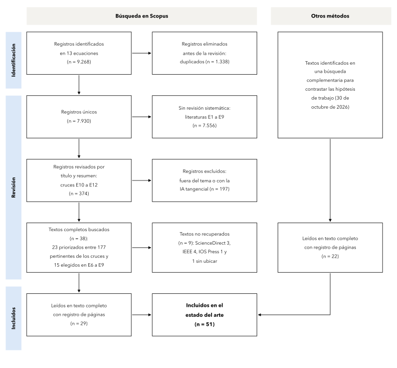
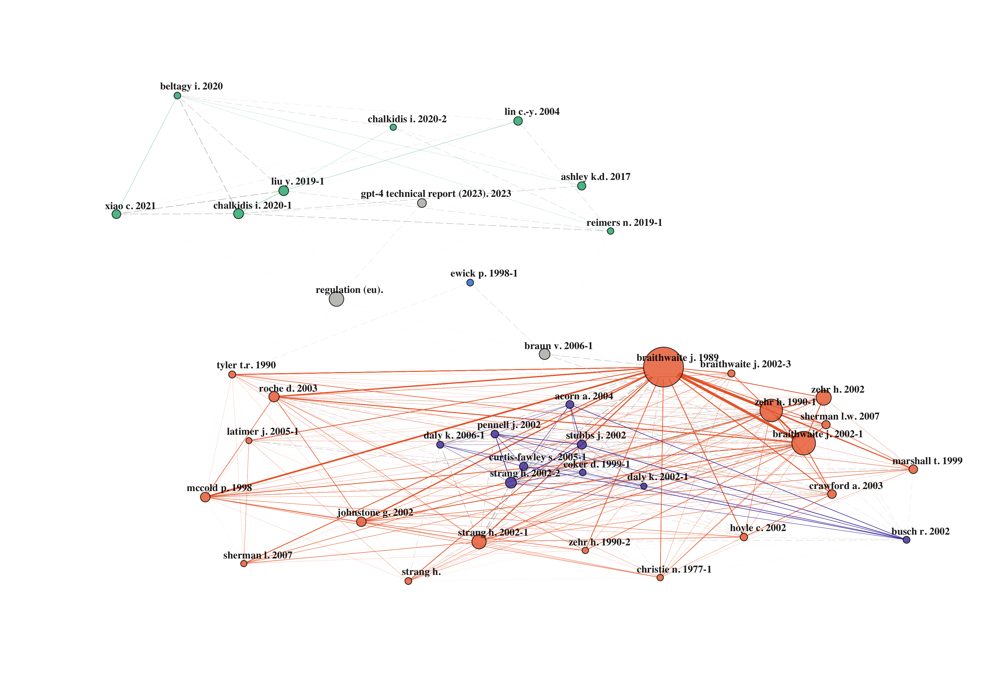
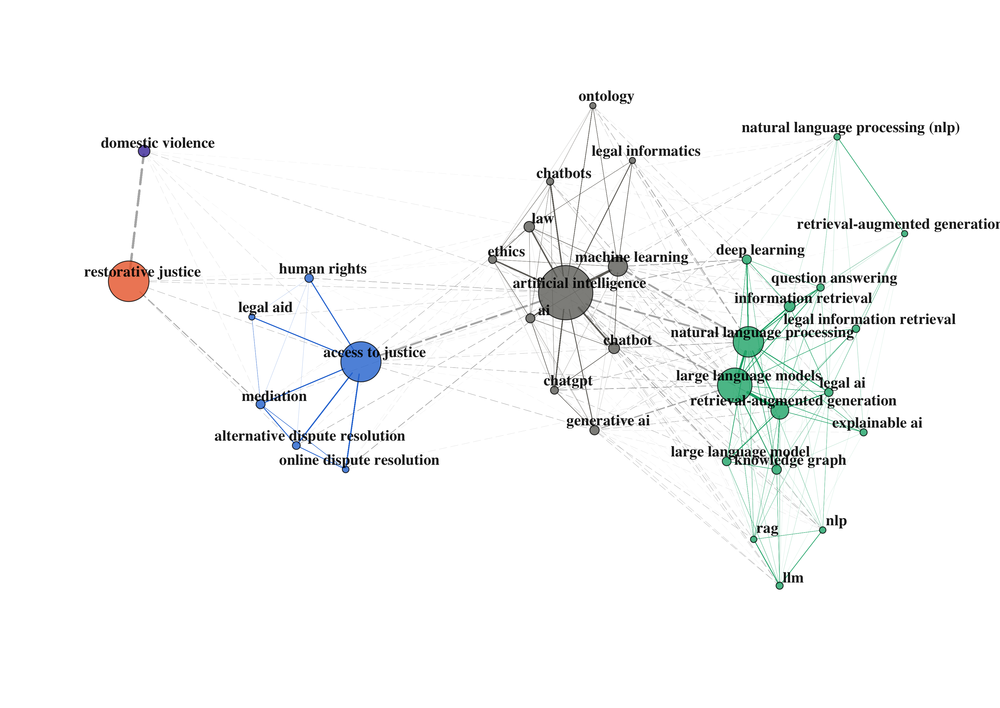
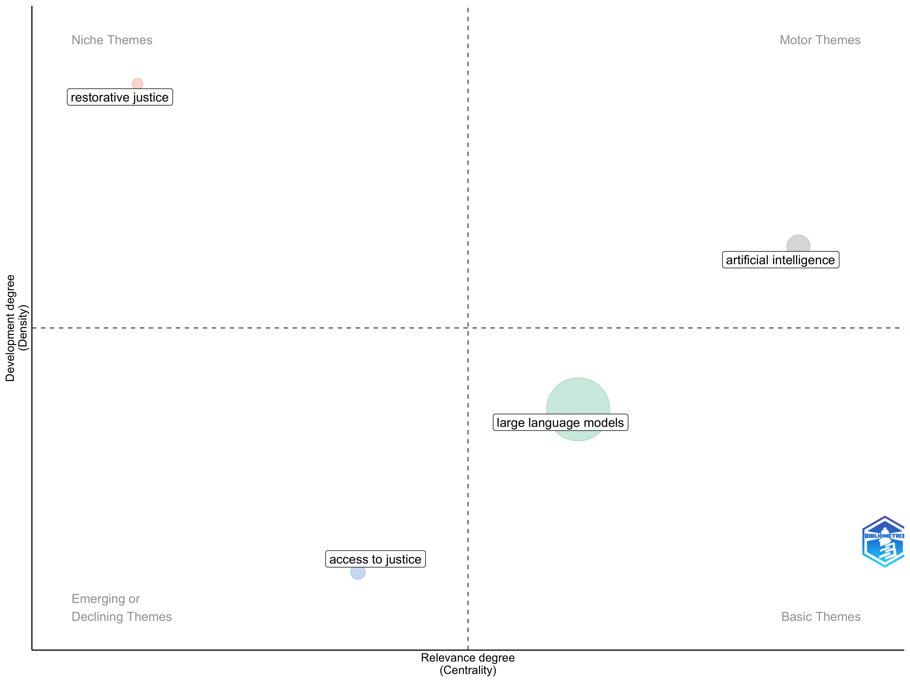
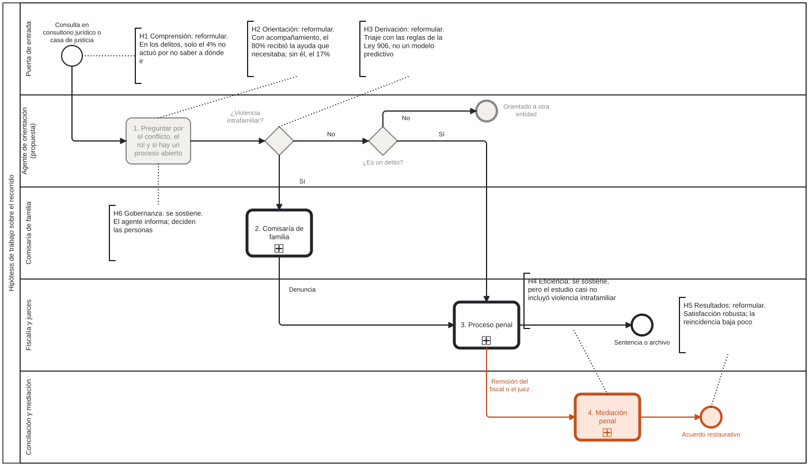

# Estado del arte

[Inicio](../README.md) · [Estado del arte](01-estado-del-arte.md) · [El Leviatán](02-leviatan.md) · [Validación](03-validacion.md)

> Versión 1, en proceso de validación con el equipo del proyecto.

## 1. Desafío planteado

El proyecto se basa en el supuesto: la gente no llega a la justicia porque no sabe a qué entidad acudir. Sin embargo, los datos de Colombia lo matizan en cierto punto. Según la Encuesta Nacional de Necesidades Jurídicas de 2020, en el 44% de los problemas legales las personas no hicieron nada (PNUD y DNP, 2023). En los delitos, solo el 4% de ellas dijo que no sabía a dónde ir. Las razones principales fueron otras: el 36% creyó que no valía la pena, el 21% no confiaba en las autoridades y el 20% no tenía pruebas. La asignación de cada porcentaje del gráfico del informe es una lectura propia. En otras palabras, la barrera principal en lo penal no está en la puerta, sino en lo que la persona espera encontrar detrás de ella.

Por otra parte, la vía restaurativa no depende solo de la ciudadanía. En Colombia la mediación penal es voluntaria y, aunque la víctima o la persona investigada pueden solicitarla, solo avanza si un fiscal o un juez evalúa su procedencia y remite el caso a un programa de mediación (Ley 906 de 2004, art. 525; Resolución 0383 de 2022, arts. 11 a 14), de modo que un agente que oriente a las personas tiene que entender también dónde se decide la ruta de un caso y quién la decide. A eso se suma que la inteligencia artificial todavía se equivoca con frecuencia cuando informa sobre derecho. Los modelos de lenguaje generales dieron respuestas falsas en entre el 58% (GPT-4) y el 88% (Llama 2) de las preguntas sobre fallos de tribunales federales de Estados Unidos (Dahl y colegas, 2024). Incluso las herramientas comerciales para abogados, que buscan en bases de datos jurídicas antes de responder, fallaron en entre el 17% y el 33% de las consultas, con respuestas incorrectas o con citas a fuentes que no las respaldan (Magesh y colegas, 2025). Por eso hay que preguntarse qué puede decir un agente sin poner en riesgo a quien lo consulta. Es por esto que el desafío es diseñar un agente que oriente sobre el sistema de justicia de Bogotá con información fiable, que haga visible la vía restaurativa donde la ley la permite y que reconozca sus límites, en particular en la violencia intrafamiliar. Para ello hay que responder por qué las personas no llegan, dónde y quién decide la vía restaurativa, y qué tan fiable es hoy la IA que informa sobre derecho.

## 2. Qué se buscó y qué se leyó

La revisión se hizo en tres pasos. Primero, una búsqueda complementaria en bases académicas sirvió para contrastar con los estudios publicados seis hipótesis levantadas a partir de las reuniones, e identificar los trabajos que las respaldan o las discuten. Después, trece búsquedas en Scopus, numeradas de E1 a E13, permitieron ampliar la revisión de forma sistemática. Por último, los 374 documentos de las búsquedas que combinan dos campos (E10 a E12) se revisaron por título y resumen con criterios explícitos, y los textos más cercanos a las preguntas del proyecto se leyeron completos: 22 en una primera ronda, centrada en las hipótesis, y 29 en una segunda, que cubrió la IA aplicada al derecho, los documentos que combinan campos y el lenguaje judicial. La Figura 1 presenta ese recorrido.

**Figura 1.** Diagrama de flujo de la búsqueda

*Nota:* E1 a E13 son las búsquedas en Scopus, en título, resumen y palabras clave, sin filtro de años. La revisión por título y resumen cubrió solo las búsquedas que combinan campos; en las búsquedas E1 a E9 los textos se eligieron por pertinencia, de modo que esta no es una revisión sistemática completa. Las búsquedas completas y la comprobación de que recuperan artículos conocidos están en [`protocolo.md`](../metodo/protocolo.md). *Fuente:* Elaboración propia con la plantilla de Page y colegas (2021).

Las trece búsquedas devolvieron 9.268 resultados, que corresponden a 7.930 documentos distintos. La Tabla 1 resume qué pregunta cada búsqueda y cuántos documentos trajo.

**Tabla 1.** Búsquedas en Scopus y documentos que trajo cada una

| Búsqueda | Pregunta | Documentos |
|---|---|---:|
| E1 | ¿Por qué la gente llega o no al sistema de justicia, y quién la orienta? | 1.814 |
| E2 | ¿Qué se sabe de las necesidades jurídicas en América Latina? | 806 |
| E3 | ¿Quién deriva a la vía restaurativa, con qué criterio y en qué etapa? | 789 |
| E4 | ¿Cabe la vía restaurativa en la violencia intrafamiliar? | 288 |
| E5 | ¿Qué efectos tiene, según los estudios de mejor diseño? | 52 |
| E6 | ¿Cómo se usa la IA para informar y orientar a la ciudadanía en asuntos jurídicos? | 2.667 |
| E7 | ¿Qué tan fiable es la IA en preguntas jurídicas? | 625 |
| E8 | ¿Cómo se representa el conocimiento jurídico para que una máquina lo use? | 1.465 |
| E9 | ¿Qué se ha medido del lenguaje judicial sobre las víctimas? | 374 |
| E10 | Combinada: IA y justicia restaurativa | 57 |
| E11 | Combinada: IA para orientar y derivar en el acceso a la justicia | 248 |
| E12 | Combinada: la vía restaurativa vista desde el acceso a la justicia | 71 |
| E13 | Combinada de los tres campos: IA, justicia restaurativa y acceso o derivación | 12 |

*Fuente:* Elaboración propia con datos de Scopus.

Las fichas de lectura de cada texto, con sus hallazgos citados con página, están en [`evidencia/`](../evidencia/).

## 3. Cuánto se citan entre sí los campos

Para saber si estos campos dialogan, se tomaron todos los pares posibles de documentos y se contó en cuántos los dos citan al menos una misma fuente, dentro de cada campo y entre campos (Tabla 2).

**Tabla 2.** Pares de documentos que citan al menos una misma fuente

| Grupos comparados | Comparten | Total de pares | % |
|---|---:|---:|---:|
| *Dentro de cada campo* | | | |
| Acceso a la justicia (2.274 documentos) | 12.748 | 2.584.401 | 0,49% |
| Justicia restaurativa (1.033) | 41.682 | 533.028 | 7,82% |
| IA y derecho (3.877) | 166.051 | 7.513.626 | 2,21% |
| Lenguaje judicial (372) | 2.604 | 69.006 | 3,77% |
| *Entre campos* | | | |
| Lenguaje judicial × restaurativa | 3.518 | 384.276 | 0,92% |
| Acceso × restaurativa | 5.255 | 2.349.042 | 0,22% |
| Acceso × IA | 4.435 | 8.816.298 | 0,05% |
| Lenguaje judicial × IA | 756 | 1.442.244 | 0,05% |
| **Restaurativa × IA** | **1.032** | **4.004.941** | **0,03%** |

*Nota:* los 374 documentos de las búsquedas combinadas (E10 a E13) no entran en estos pares, porque cada documento se asigna a un solo campo. Entre la justicia restaurativa y la IA, las fuentes comunes más citadas son manuales de método (Braun y Clarke, PRISMA, Cohen, Creswell) y clásicos de teoría (Rawls, Hart, Crenshaw, Tyler). El cálculo está en [`corpus.py`](../metodo/corpus.py) y su salida completa en [`conexion.txt`](../datos/bibliometria/conexion.txt). *Fuente:* Elaboración propia con datos de Scopus.

La justicia restaurativa es el campo más cohesionado y el acceso a la justicia, el más disperso. Entre campos, en cambio, los vínculos caen a fracciones mínimas, y el más débil es justamente el que interesa al proyecto: entre la justicia restaurativa y la inteligencia artificial, menos de 3 de cada 10.000 pares citan una misma fuente. Además, lo poco que comparten son manuales de método y clásicos de teoría, no hallazgos sobre el tema.

## 4. Cómo se organiza cada campo

Las tres figuras de esta sección se construyeron con el paquete bibliometrix de R sobre los 7.930 documentos. La primera muestra en qué autores se apoya cada campo, la segunda de qué hablan los documentos y la tercera qué tan conectado y desarrollado está cada tema.

**Figura 2.** Fuentes que se citan juntas: las 40 con más vínculos entre las 300 más citadas

*Nota:* dos fuentes se unen cuando un mismo documento las cita juntas; el tamaño de cada círculo es el número de veces que se cita junto a otras, y los grupos los forma un algoritmo de agrupación (walktrap). Naranja, el canon de la justicia restaurativa; violeta, la crítica feminista a su uso en la violencia de género; aguamarina, la IA jurídica; azul, la conciencia jurídica; en gris, referencias que no forman grupo. *Fuente:* Elaboración propia con datos de Scopus.

La Figura 2 muestra dos islas. Abajo está la justicia restaurativa, que se divide en dos grupos muy unidos entre sí: el canon, con Braithwaite (1989), Zehr (1990), Strang (2002) y McCold (1998), al que se suma la justicia procedimental de Tyler (1990), y la crítica feminista a su uso en la violencia de género, con Stubbs, Daly, Coker y Acorn. Arriba, lejos, está la IA jurídica, que cita modelos de lenguaje adaptados al derecho (Chalkidis, Xiao, Beltagy) y el manual de razonamiento jurídico computacional de Ashley (2017). Entre ambas islas, las líneas son pocas y tenues. Cabe notar que el campo del acceso a la justicia, aunque aporta 2.274 documentos, no alcanza a formar un grupo propio entre las referencias más citadas, lo que coincide con su baja cohesión en la Tabla 2.

**Figura 3.** Palabras clave que aparecen juntas: las 35 con más vínculos entre las 300 más frecuentes

*Nota:* dos palabras clave se unen cuando las ponen juntas los autores de al menos dos documentos. Azul, acceso a la justicia y mecanismos alternativos; naranja, justicia restaurativa; violeta, violencia intrafamiliar; gris oscuro, IA en general; aguamarina, modelos de lenguaje y recuperación de información. *Fuente:* Elaboración propia con datos de Scopus.

En las palabras clave la separación se repite, aunque con matices. El acceso a la justicia se agrupa con la mediación, la resolución alternativa y en línea de disputas y la asistencia legal, y desde ahí se conecta con la IA. La IA, a su vez, se divide en un grupo general (ética, chatbots, IA generativa) y uno técnico (modelos de lenguaje, generación aumentada por recuperación, grafos de conocimiento). En cambio, «restorative justice» y «domestic violence» quedan cada una sola en un borde de la red, unidas al resto por enlaces débiles, lo que indica que la justicia restaurativa casi no comparte vocabulario con la IA ni con el acceso a la justicia.

**Figura 4.** Mapa temático: qué tan conectado y qué tan desarrollado está cada tema

*Nota:* el eje horizontal es la centralidad, es decir, cuánto se conecta el tema con los demás, y el vertical es la densidad, es decir, cuánto se trabaja por dentro. Arriba a la izquierda están los temas de nicho, arriba a la derecha los motores, abajo a la derecha los básicos y abajo a la izquierda los emergentes o en declive. *Fuente:* Elaboración propia con datos de Scopus.

El mapa temático resume lo anterior. La justicia restaurativa es un tema de nicho, desarrollado por dentro pero desconectado del resto. La inteligencia artificial es un tema motor, mientras que los modelos de lenguaje son un tema básico. El acceso a la justicia, por su parte, aparece con baja centralidad y baja densidad, lo que sugiere un campo amplio que no se articula alrededor de un vocabulario común. El agente que propone el proyecto trabaja precisamente entre el nicho restaurativo y el tema básico de los modelos de lenguaje.

## 5. Lo que sostiene la lectura completa

La revisión partió de seis hipótesis de trabajo se formularon a partir de lo conversado en las reuniones con el equipo y con los expertos consultados. Los 51 textos leídos completos permitieron contrastarlas con los datos de cada estudio y no con sus resúmenes, y el resultado es que cuatro hay que reformularlas y dos se sostienen, una de ellas con un límite. La Tabla 3 resume cada hipótesis con su veredicto.

**Tabla 3.** Hipótesis de trabajo y veredicto tras la lectura completa

| Hipótesis | Veredicto | Qué muestra la lectura | Sección |
|---|---|---|---|
| **H1. Comprensión.** El bajo uso de la justicia restaurativa se explica, en parte, por desconocimiento de las rutas y del modelo, y no solo por falta de oferta institucional | Reformular | En los delitos, solo el 4% de quienes no actuaron dijo no saber a dónde acudir; pesan más creer que no vale la pena, la desconfianza y la falta de pruebas (PNUD y DNP, 2023; Pleasence y colegas, 2003). El agente tendría que explicar qué se puede lograr y qué hace falta, y no solo indicar la puerta | 5.1 |
| **H2. Orientación.** Un agente que explique el modelo en lenguaje simple y oriente a la entidad competente aumenta la llegada efectiva de casos a los mecanismos restaurativos | Reformular | La orientación rinde más cuando alguien acompaña: el 80% de quienes tuvieron ayuda dijo que la herramienta le dio toda o casi toda la ayuda que necesitaba, frente al 17% de quienes la usaron solos (Sykes y colegas, 2020). El usuario principal pasaría del ciudadano solo a la puerta con un orientador | 5.2 |
| **H3. Derivación.** El triaje asistido en el ingreso identifica antes los casos aptos para la vía restaurativa | Reformular | Quien deriva decide por intuición (Hoekstra, 2022; Sandbye y colegas, 2024), y en Colombia la elegibilidad la fijan reglas de la Ley 906. El triaje se plantea por reglas que dejen visible al elegible, y no como un modelo predictivo | 5.3 |
| **H4. Eficiencia.** La derivación temprana reduce los tiempos de resolución y la carga de la vía ordinaria | Se sostiene, con un límite | La probabilidad estimada de volver al tribunal penal en un año fue de 1,7% con mediación frente a 8,2% sin ella, y la mediación costó 97% menos (Charkoudian y colegas, 2021; Lounkaew, 2026). En cambio, en el estudio de Maryland los casos de violencia doméstica por lo general no se derivaban a mediación, de modo que el resultado no se extiende a ella | 5.4 |
| **H5. Resultados.** Los casos resueltos por vía restaurativa muestran menor reincidencia y mayor satisfacción | Reformular | La satisfacción de la víctima es robusta, pero la reducción de la reincidencia es pequeña y depende del diseño del estudio (Fulham y colegas, 2025; Strang y colegas, 2013). En la violencia intrafamiliar no hay datos sobre el bienestar de la víctima (Kettrey y Reynolds, 2026) | 5.4 y 5.5 |
| **H6. Gobernanza.** El sistema solo es legítimo si la IA orienta y deriva, y la decisión queda en manos de facilitadores y operadores humanos | Se sostiene | Las herramientas jurídicas comerciales dieron respuestas falsas o mal respaldadas entre el 17% y el 33% de las veces (Magesh y colegas, 2025), y la sentencia T-323 de 2024, dirigida a los jueces, recomienda que la IA no especializada solo dé información descriptiva y no normativa. Además de un límite, la hipótesis da una regla de diseño: el agente informa y no resuelve | 5.6 |

*Fuente:* Elaboración propia. Los enunciados de las hipótesis son del autor, a partir de las reuniones con el equipo y con los expertos consultados; el contraste detallado, con citas y páginas, está en [`hipotesis.md`](../evidencia/hipotesis.md).

La Figura 5 ubica cada hipótesis en el paso del recorrido donde actúa, sobre la misma vista general del [Leviatán](02-leviatan.md). Cuatro de ellas (H1, H2, H3 y H6) actúan en la puerta o en la tarea del agente, y tres de esas cuatro hay que reformularlas. En cambio, H4 y H5 actúan cuando el caso ya llegó a la mediación.

**Figura 5.** Hipótesis de trabajo sobre el recorrido de una persona

*Nota:* cada anotación lleva la hipótesis y su veredicto. En gris, la propuesta del proyecto por validar; en naranja, la vía restaurativa. *Fuente:* Elaboración propia. Archivo editable: [`hipotesis.bpmn`](../procesos/hipotesis.bpmn).

### 5.1 La barrera no está en la puerta

Los estudios sobre necesidades jurídicas coinciden en que las personas dejan de actuar menos por no saber a dónde ir que por no reconocer su problema como jurídico o por creer que nada se puede hacer. En Inglaterra y Gales, menos del 5% de quienes no hicieron nada mencionó el costo como razón, y en la violencia doméstica el 32% no actuó porque creía que no se podía hacer nada (Pleasence y colegas, 2003). En Estados Unidos, entre las razones más importantes están no ver el problema como legal y creer que ya se hace lo posible, mientras que el costo explicó el 17% de los problemas sin ayuda en una ciudad de tamaño medio en 2013 y el 6% en el estudio nacional de los noventa (Sandefur, 2016). En Colombia, el dato del PNUD y el DNP (2023) va en la misma dirección, y Hilbink y colegas (2022) muestran, con grupos focales en Medellín y Santiago, que la desconfianza tampoco explica por sí sola la decisión de acudir, porque pesan más las expectativas y la capacidad de agencia legal. Guarin y colegas (2024) agregan que, entre las madres custodias de Colombia, las más vulnerables son las que más problemas de familia tienen y las que menos buscan ayuda institucional. Por lo tanto, un agente que solo indique la puerta atacaría la barrera menor, y lo que necesita es explicar qué se puede lograr y qué hace falta para lograrlo. Sin embargo, la vía restaurativa es una excepción, porque ahí la puerta tampoco la conocen quienes deben derivar. En Ghana, de los 12 paneles de mediación para menores de los distritos visitados, solo uno funcionaba, porque nadie les remitía casos y los propios funcionarios no sabían que existían (Ame y colegas, 2020). De ahí que el agente deba hacer visible la vía también ante el orientador.

### 5.2 Orientar rinde cuando alguien acompaña

Las herramientas de orientación funcionan mejor con una persona al lado. En el tribunal en línea de Columbia Británica, 16 de 20 usuarios que tuvieron ayuda (80%) dijeron que el explorador de soluciones les dio toda o casi toda la ayuda que necesitaban, frente a 5 de 29 de quienes lo usaron solos (17%), aunque se trata de una encuesta exploratoria que mide la ayuda percibida y no casos resueltos (Sykes y colegas, 2020). En Burundi, la asistencia legal de asesores locales aumentó el uso de los tribunales, pero no cambió el uso de los mecanismos alternativos (Chaara y colegas, 2022). En los textos leídos de IA aplicada al derecho, ningún estudio compara el rendimiento con y sin acompañamiento. Además, en JusticeBot el 52% de los usuarios de los últimos 60 días eligió la opción «Otro» del menú, lo que según los autores indica que no encontraron la ruta adecuada o que su problema no estaba cubierto (Westermann y Benyekhlef, 2023). De ahí que orientar no lleve por sí solo a la vía restaurativa, y que el agente rinda más desde una puerta con un orientador, como el Centro de Recepción e Información de las casas de justicia, que solo frente al ciudadano.

### 5.3 Quien deriva decide la vía restaurativa

En los países donde se ha estudiado, la derivación a la vía restaurativa depende del juicio del operador. En Países Bajos, 33 entrevistas mostraron que los policías ofrecen la vía restaurativa sin protocolo y por intuición, y sus relatos dejan ver que también pesa su juicio moral sobre la víctima y el ofensor (Hoekstra, 2022). En un distrito de Dinamarca, los policías ven el aviso de mediación como una formalidad blanda, que se olvida o se posterga, y muchos conocen poco el programa (Sandbye y colegas, 2024). Además, según entrevistas con 13 informantes de 5 de los 12 distritos policiales daneses, entre ellos seis coordinadores de mediación, que a las partes se les informe de la mediación varía según el distrito y el policía, y en la mayoría de los casos no se les informa por desconocimiento (Rasmussen, 2020). Son estudios cualitativos y exploratorios, pero coinciden en el mecanismo. Por otra parte, la discrecionalidad no solo restringe la vía, porque en Finlandia algunos fiscales derivan a mediación pese a la negativa inicial de las partes y algunos funcionarios cierran el caso antes de que se cumpla el acuerdo (Jauhiainen, 2025; Jauhiainen y Obstbaum, 2026, que comparten la misma base de entrevistas). En Colombia ocurre algo análogo, porque solo el fiscal o el juez pueden remitir un caso penal a mediación, en principio a un programa con convenio y, donde no lo hay, a otros programas o a funcionarios capacitados de la Fiscalía (Resolución 0383 de 2022, art. 14; Resolución 0447 de 2023, art. 2). En consecuencia, la elegibilidad se puede expresar como reglas que hagan visible el caso elegible, sin necesidad de un modelo predictivo, siempre que esas reglas lleguen al operador cuando decide, porque en Finlandia las pautas escritas existían pero no se usaban (Jauhiainen, 2025).

Desde el lado de quien busca la vía, la búsqueda combinada E12 reúne 71 documentos, de los cuales 17 son pertinentes. Entre ellos, una encuesta checa a 3.577 personas encontró que solo el 31% identificaba qué es la mediación, en general y no la penal, y estaba seguro de su respuesta, que el desconocimiento era mayor entre quienes tenían menos educación e ingresos o vivían en municipios pequeños, y que menos de 1 de cada 10 de quienes conocían el término sabía cómo encontrar un mediador. Además, solo el 1,6% había pasado por una mediación penal, y la mayoría llegó porque una autoridad o el servicio de mediación le informó (Holá y colegas, 2026). En Colombia, un estudio sobre los consultorios jurídicos de Cartagena concluye que la mediación penal en ellos es «prácticamente inexistente o, en el mejor de los casos, incipiente y no documentada» (Beetar Bechara y Martínez Montenegro, 2026). La revisión está en [`revision-e12.csv`](../datos/revision-e12.csv).

### 5.4 Lo robusto es la satisfacción de la víctima

Los metaanálisis coinciden en que la justicia restaurativa mejora la experiencia de la víctima, pero no en cuánto reduce la reincidencia. Fulham y colegas (2025) encontraron una reducción del 17% en la razón de probabilidades (odds) de reincidencia general, que deja de ser significativa en la reincidencia violenta y en los ensayos aleatorios, mientras que el efecto sobre la satisfacción de la víctima es mayor (d = 0,63). La revisión Campbell de Strang y colegas (2013), con diez ensayos aleatorios, halló una reducción pequeña de la reincidencia a dos años (d = 0,155), algo mayor en delitos violentos (d = 0,20) y prácticamente nula en delitos contra la propiedad, aunque la diferencia entre ambos grupos no fue significativa, y la satisfacción de las víctimas fue mayor en todos los ensayos que la midieron. Por su parte, Islam y colegas (2023) sí encontraron un efecto significativo en los delitos violentos, a diferencia de Fulham. Por eso la medida más defendible para un piloto es la satisfacción y la justicia procedimental de quienes pasan por el proceso.

### 5.5 En la violencia intrafamiliar la evidencia no alcanza

La violencia intrafamiliar es el límite más claro. La revisión de Kettrey y Reynolds (2026) encontró solo cuatro estudios elegibles en violencia sexual y doméstica, con un efecto que no es significativo en los ensayos aleatorios y sin ninguna medición del bienestar de la víctima. Además, la práctica documentada es preocupante: en Inglaterra la policía usó el lenguaje restaurativo para cerrar casos sin más acción (Westmarland y colegas, 2018), en Brasil la invitación al círculo puede vivirse como una citación, porque una mujer en situación de violencia difícilmente la rechaza, y las mujeres lo vivieron como terapia o reconciliación (De Campos y De Oliveira, 2021), y la revisión de Hudson y Berger (2026) identifica como riesgos principales el desequilibrio de poder, la retraumatización y los facilitadores sin formación. En Java Central, la policía media después de explicarle a la víctima las consecuencias del juicio, y fuera del tribunal no se exige formación a quien media (Sukendar y colegas, 2023). En la norma colombiana el límite es condicional y no absoluto. Ninguna ley excluye expresamente la violencia intrafamiliar de la mediación, que desde la Ley 1959 de 2019 se tramita por el procedimiento abreviado, donde la mediación puede extinguir la acción hasta antes del fallo de primera instancia (Ley 906 de 2004, art. 547). Sin embargo, si en ese procedimiento rigiera el límite de pena mínima de cinco años del artículo 524, la violencia intrafamiliar agravada, cuya pena mínima supera los seis años, quedaría fuera, y ninguna norma ni sentencia consultada resuelve ese punto. La Resolución 0383 de 2022 excluye la mediación en violencia de género cuando la valoración del riesgo es grave o extrema (art. 12) y fija reuniones previas por separado para todos los casos (art. 16), mientras que el manual de justicia restaurativa de la Fiscalía agrega, para la violencia intrafamiliar, que la víctima no debe ser confrontada con el agresor (apartado 3.5.3, en una copia no oficial). En cambio, la Directiva 0001 de 2021 de la Fiscalía la declara no conciliable ni desistible, y falta saber si sigue vigente; además, la Resolución 0-0211 de 2025, que creó la Unidad de Justicia Restaurativa, no derogó expresamente el manual. El detalle está en [`normas-fiscalia.md`](../evidencia/normas-fiscalia.md). Fuera de la violencia intrafamiliar, el riesgo para la víctima aparece cuando la reparación depende de lo que el ofensor puede pagar. En Uzbekistán, en 1.249 sentencias por lesiones de tránsito, el 85% de los casos con peatones terminó en reconciliación y ninguna sentencia registró el monto pagado, por lo que los autores concluyen que quienes pueden pagar compran el perdón (Shamsidinov y colegas, 2026). Por eso, cuando el agente muestre la vía restaurativa, también debería decir qué se acuerda y qué alternativas tiene la víctima. Esto sugiere que la primera iteración del agente no debería ofrecer mediación en violencia intrafamiliar, y que la inasistencia alimentaria es un caso más seguro para empezar.

### 5.6 La IA jurídica construye mucho y evalúa poco

De los 248 documentos de la búsqueda combinada E11, la revisión por título y resumen dejó 86 que diseñan o evalúan un sistema de IA que orienta, clasifica o deriva a personas que no son abogados, 48 que discuten el tema sin sistema ni datos y 114 fuera del tema. Cerca de la mitad de los 86 (45) son de la India, por sus autores o por el caso que tratan, y la mayoría son prototipos; según sus resúmenes, solo 11 se evaluaron con usuarios, 41 únicamente con métricas del modelo y 34 no se evaluaron. Además, 11 tocan lo penal, pero cerca de la mitad lo hace para identificar el artículo aplicable del código, y ninguno deriva a una vía alternativa al proceso. La revisión está en [`revision-e11.csv`](../datos/revision-e11.csv).

La lectura completa de los trabajos más cercanos al proyecto precisa ese panorama. Estos trabajos resuelven tres pasos distintos de la puerta de entrada: orientar al lego por rutas construidas con la ley y la jurisprudencia, y traducir su relato a la ruta que le sirve (Westermann y Benyekhlef, 2023; Westermann y colegas, 2023); decidir si califica para un servicio (Steenhuis y Westermann, 2024); y clasificar su problema para asignarle un abogado o referirlo (Mistica y colegas, 2021; Steenhuis, 2025). Sin embargo, salvo JusticeBot, que reporta más de 20.000 usos y una encuesta de satisfacción respondida por 35 usuarios, los mejores trabajos se evalúan con textos reales sin personas o con escenarios generados con ChatGPT, y ninguno mide si quien lo usó resolvió su problema. Asimismo, la equidad entre grupos casi no se mide, y el único estudio que la examinó encontró que el clasificador rendía peor con los mayores de 65 años (Mistica y colegas, 2021). Fuera de lo penal sí aparece la vía amistosa, porque JusticeBot incluye el arreglo directo entre los próximos pasos que muestra y el proyecto europeo IDEA diseña un chatbot que oriente hacia la negociación, la mediación o el juicio en despidos, aunque todavía sin resultados (Molinari y Giacalone, 2026). En Colombia hay dos antecedentes, un clasificador de casos del consultorio jurídico de la Universidad Santo Tomás, que todavía no se pudo leer completo, y un prototipo que aplica modelado de temas al relato en texto libre de los casos que atiende la Personería de Medellín, más de 16.000 al año, donde predominan los reclamos de salud contra las EPS. Sin embargo, este último no clasifica ni deriva casos y no informa ninguna evaluación de su modelo (Espinosa y colegas, 2024).

En paralelo, la fiabilidad sigue siendo el problema central. Además de las cifras de error de la sección 1, parte del error de las herramientas comerciales consiste en citar fuentes reales que no sostienen lo afirmado, lo que es más difícil de detectar que un caso inventado (Magesh y colegas, 2025). Por su parte, los modelos generales aceptaron premisas falsas en preguntas sobre fallos, GPT-4 en el 69% de ellas (Dahl y colegas, 2024), aunque en el banco de Magesh y colegas el mismo GPT-4 y dos de las herramientas a menudo corrigieron la premisa, de modo que la complacencia con el usuario depende del modelo y de la pregunta. Ninguno de los dos estudios observa a personas sin formación jurídica, si bien Dahl y colegas concluyen que el riesgo es mayor para quienes litigan sin abogado.

Sobre qué puede decir un agente, los textos leídos convergen en acotar la tarea y declarar sus límites. Las herramientas con tareas jurídicas específicas son más fáciles de evaluar que los chats abiertos (Magesh y colegas, 2025), un chatbot público que solo informa puede responder consultando una tabla de decisión, lo que hace más fácil explicar en qué se funda la respuesta que cuando el algoritmo es generativo (Makasi y colegas, 2020), y avisar que se habla con una máquina no garantiza la veracidad de lo que dice, por lo que la respuesta debe señalar su incertidumbre y remitir a la fuente (Wachter y colegas, 2024). En Colombia no hay una ley que regule estos sistemas, y las normas vigentes acotan al agente por tres vías: lo reservado a los abogados (Decreto 196 de 1971), el tratamiento de datos sensibles (Ley 1581 de 2012; Circular Externa 002 de 2024 de la Superintendencia de Industria y Comercio) y los criterios de la Rama Judicial, que solo la obligan a ella, pero admiten usar la IA para orientar a la ciudadanía siempre que no interprete hechos ni resuelva casos (Sentencia T-323 de 2024; Acuerdo PCSJA24-12243 de 2024, art. 12.1.b). Ninguna norma define dónde termina orientar y empieza asesorar. El detalle, con citas y enlaces, está en [`normas-ia.md`](../evidencia/normas-ia.md).

Por último, de los 57 documentos que cruzan IA y justicia restaurativa, solo cuatro aplican la IA a un proceso restaurativo penal. Dos analizan señales no verbales en mediaciones víctima-ofensor grabadas en Cataluña para predecir el acuerdo y la satisfacción que registra el mediador (Ponce-López y colegas, 2013, 2015), y otros dos, que todavía no se han podido leer completos, estudian la IA en la mediación de procesos penales en China (Lu, 2025) y simulan intervenciones restaurativas con agentes (Ali y colegas, 2026). Un quinto trabajo no aplica la IA a un proceso, pero mide lo que tres modelos de lenguaje (Gemini, Grok y DeepSeek) dirían sobre la vía restaurativa ante un abuso sexual intrafamiliar o extrafamiliar: los modelos se mostraron más abiertos a ella que las 469 personas encuestadas y variaron entre sí, mientras que un cuarto modelo, ChatGPT, se negó a responder y quedó excluido, por lo que los autores piden derivación profesional (Peleg-Koriat y Asraf, 2026). La revisión está en [`revision-e10.csv`](../datos/revision-e10.csv).

## 6. Lo que los estudios no han cubierto

Los estudios revisados tienen las piezas del proyecto por separado. Los de acceso a la justicia explican por qué las personas no llegan, pero no tratan la vía restaurativa; los de justicia restaurativa muestran quién decide derivar, pero no hablan de inteligencia artificial; y los de IA aplicada al derecho construyen herramientas para la puerta de entrada, pero las evalúan con textos y no con personas y, en lo penal, no conectan con las rutas restaurativas. La Figura 6 lo resume.

**Figura 6.** Lo que cubre cada campo frente a lo que el proyecto necesita reunir

| Campo | Explica por qué la gente no llega | Muestra quién decide la vía restaurativa | Fija límites en violencia intrafamiliar | Orienta con IA fiable | Representa el conocimiento jurídico para una máquina |
|---|:---:|:---:|:---:|:---:|:---:|
| Acceso a la justicia | ✓ | ~ | ✗ | ~ | ✗ |
| Justicia restaurativa | ~ | ✓ | ✓ | ✗ | ✗ |
| IA y derecho | ✗ | ✗ | ✗ | ~ | ~ |
| Lenguaje judicial | ✗ | ✗ | ~ | ✗ | ✗ |
| Búsquedas combinadas | ~ | ✗ | ~ | ~ | ✗ |
| **Este proyecto** | **✓** | **✓** | **✓** | **✓** | **✓** |

✓ lo estudia · ~ lo toca en parte · ✗ no lo estudia

*Nota:* las columnas son lo que el proyecto necesita reunir según las preguntas de la sección 1. En IA y derecho, lo que se representa son sobre todo normas, fallos y argumentos, mientras que las ontologías son escasas y ninguno de los textos leídos representa rutas procedimentales completas: JusticeBot codifica rutas de criterios jurídicos que terminan en próximos pasos, pero no el recorrido institucional del caso. *Fuente:* Elaboración propia a partir de las secciones 3 a 5.

Además, los estudios sobre el lenguaje judicial describen cómo las sentencias nombran a las víctimas, pero no miden el efecto de ese lenguaje. En 20 sentencias españolas de casación por violencia de género, la violación nunca se nombra al relatar los hechos y la víctima aparece reducida a ese rol, casi sin mención de su resistencia (Mestre-Mestre, 2023). En las sentencias inglesas sobre mujeres que matan, la forma de nombrar a la acusada construye narrativas dicotómicas que la presentan como víctima degradada o como monstruo deshumanizado (Potts y Weare, 2018), y en el Tribunal Penal Internacional para la ex Yugoslavia la población se nombra de forma genérica y la responsabilidad con términos variables que dejan ambiguo qué se atribuye a cada acusado (Potts y Kjær, 2016). En Australia del Sur, en 7 de los 10 casos de delitos sexuales juveniles que los jueces trataron como sexo consentido entre pares, la víctima había denunciado una violación, y en esos fundamentos el juez puso el acento en la norma infringida y no en el daño a la víctima (Bouhours y Daly, 2007). Ninguno de estos estudios trata Colombia, mide el efecto del lenguaje en las víctimas ni evalúa una herramienta que corrija sentencias.

Queda abierto, entonces, cómo un agente de IA puede orientar a las personas en Bogotá sobre el sistema de justicia con información fiable, hacer visible la vía restaurativa donde la ley la permite y dejarla fuera donde la evidencia no la respalda, apoyando al operador que decide en lugar de reemplazarlo.

## Referencias

Ali, K. A. R., Somu, C. S. y Bang, S. (2026). Applying a multi-agent simulation model for examining restorative justice-based intervention in the criminal justice system: A legal and technological perspective. En *2026 IEEE 3rd International Conference on Emerging Trends in Engineering and Medical Sciences*. https://doi.org/10.1109/ICETEMS66917.2026.11469421

Ame, R., Ayete-Nyampong, L. y Gakpleazi, D. A. (2020). 'There's no functioning child panel in this region': An assessment of child panels in Ghana's juvenile justice system. *Contemporary Justice Review, 23*(4), 373–400. https://doi.org/10.1080/10282580.2020.1719362

Beetar Bechara, B. y Martínez Montenegro, I. (2026). Implementación de la mediación penal en consultorios jurídicos de Cartagena: avances y desafíos en justicia restaurativa. *Revista Científica General José María Córdova, 24*(55), 731–762. https://doi.org/10.21830/19006586.1583

Bouhours, B. y Daly, K. (2007). Youth sex offenders in court: An analysis of judicial sentencing remarks. *Punishment & Society, 9*(4), 371–394. https://doi.org/10.1177/1462474507080473

Chaara, I., Falisse, J.-B. y Moriceau, J. (2022). Does legal aid improve access to justice in 'fragile' settings? Evidence from Burundi. *Journal of Peace Research, 59*(6), 810–827. https://doi.org/10.1177/00223433211055633

Charkoudian, L., Walter, J., Harmon-Darrow, C. y Bernstein, J. (2021). Mediation in criminal misdemeanor cases. *Criminology, Criminal Justice, Law & Society, 22*(3), 14–29.

Dahl, M., Magesh, V., Suzgun, M. y Ho, D. E. (2024). *Large legal fictions: Profiling legal hallucinations in large language models* (arXiv:2401.01301v2) [Preprint]. arXiv. https://doi.org/10.48550/arXiv.2401.01301. Publicado en *Journal of Legal Analysis, 16*(1), 64–93.

De Campos, C. H. y De Oliveira, C. R. (2021). Judicial restorative justice and domestic violence in Brazil: Setting problems and challenges from the field. *International Journal for Crime, Justice and Social Democracy, 10*(4), 146–157. https://doi.org/10.5204/ijcjsd.2015

Espinosa, J. E., Mateus, S. P. y Ramirez, D. M. (2024). Text analysis software using topic modeling techniques for the extraction of knowledge from cases related to vulnerability and access to justice. En H. Degen y S. Ntoa (Eds.), *HCII 2024* (Lecture Notes in Artificial Intelligence, Vol. 14736, pp. 334–352). Springer. https://doi.org/10.1007/978-3-031-60615-1_23

Fulham, L., Blais, J., Rugge, T. y Schultheis, E. A. (2025). The effectiveness of restorative justice programs: A meta-analysis of recidivism and other relevant outcomes. *Criminology and Criminal Justice, 25*(5), 1486–1512. https://doi.org/10.1177/17488958231215228

Guarin, A., Cuesta, L. y Eickmeyer, K. J. (2024). Family issues and custodial mothers' quest for justice: Evidence from Colombia. *Family Process, 63*(2), 803–820. https://doi.org/10.1111/famp.12959

Hilbink, L., Salas, V., Gallagher, J. K. y Restrepo Sanín, J. (2022). Why people turn to institutions they detest: Institutional mistrust and justice system engagement in uneven democratic states. *Comparative Political Studies, 55*(1), 3–31. https://doi.org/10.1177/00104140211024299

Hoekstra, M. S. (2022). Messy victims and sympathetic offenders: The role of moral judgments in police referrals to restorative justice. *Contemporary Justice Review, 25*(2), 179–197. https://doi.org/10.1080/10282580.2022.2084087

Holá, L., Fiedor, D., Urbanová, M. y Kovařík, F. (2026). Mediation in criminal proceedings: Knowledge and experience of the Czech public. *European Journal on Criminal Policy and Research*. https://doi.org/10.1007/s10610-026-09693-w

Hudson, A. y Berger, E. (2026). Restorative justice processes and intimate partner violence: A qualitative systematic review of perceived benefits, risks, and best practices for victims. *Trauma, Violence, and Abuse*. https://doi.org/10.1177/15248380261433020

Islam, M. S., Li, B. y Anderson, J. (2023). An assessment of the potential outcomes in practising restorative justice in criminal settings in Australia and the United States: A systematic review and meta-analysis. *Contemporary Justice Review, 26*(3), 262–298. https://doi.org/10.1080/10282580.2023.2297833

Jauhiainen, A. (2025). Gatekeeping or gate-pushing restorative justice? *Nordic Journal of Studies in Policing, 12*(1), 1–22. https://doi.org/10.18261/njsp.12.1.4

Jauhiainen, A. y Obstbaum, Y. (2026). Police and prosecutors' views on victim–offender mediation in Finland: Inequities in pathways to justice? *International Review of Victimology*. https://doi.org/10.1177/02697580261424265

Kettrey, H. H. y Reynolds, N. S. (2026). Is restorative justice appropriate for sexual assault and domestic violence? A systematic review and meta-analysis of the "empirical vacuum". *Journal of Experimental Criminology, 22*(1), 229–247. https://doi.org/10.1007/s11292-024-09651-8

Lounkaew, K. (2026). Beyond diversion: The economic and institutional impact of criminal mediation in Thailand. *Frontiers in Sociology, 11*, 1857910. https://doi.org/10.3389/fsoc.2026.1857910

Lu, Y. (2025). Optimization study of artificial intelligence on dispute resolution models in criminal proceedings. *Cadernos de Dereito Actual*, (28), 14–27.

Magesh, V., Surani, F., Dahl, M., Suzgun, M., Manning, C. D. y Ho, D. E. (2025). Hallucination-free? Assessing the reliability of leading AI legal research tools. *Journal of Empirical Legal Studies, 22*(2), 216–242. https://doi.org/10.1111/jels.12413

Makasi, T., Nili, A., Desouza, K. C. y Tate, M. (2020). Chatbot-mediated public service delivery: A public service value-based framework. *First Monday, 25*(12). https://doi.org/10.5210/fm.v25i12.10598

Mestre-Mestre, E. M. (2023). Representation of gender violence in appeal proceedings in Spain: A corpus pragmatics analysis. *Revista de Llengua i Dret, Journal of Language and Law*, (79), 158–175. https://doi.org/10.58992/rld.i79.2023.3927

Mistica, M., Lau, J. H., Merrifield, B., Fazio, K. y Baldwin, T. (2021). Semi-automatic triage of requests for free legal assistance. En *Proceedings of the Natural Legal Language Processing Workshop 2021* (pp. 217–227).

Molinari, M. y Giacalone, M. (2026). AI and digital justice in EU labor law. A comparative study on predictive tools and judicial transformation. *Frontiers in Artificial Intelligence, 8*, 1742239. https://doi.org/10.3389/frai.2025.1742239

Page, M. J., McKenzie, J. E., Bossuyt, P. M., Boutron, I., Hoffmann, T. C., Mulrow, C. D., Shamseer, L., Tetzlaff, J. M., Akl, E. A., Brennan, S. E., Chou, R., Glanville, J., Grimshaw, J. M., Hróbjartsson, A., Lalu, M. M., Li, T., Loder, E. W., Mayo-Wilson, E., McDonald, S., … Moher, D. (2021). The PRISMA 2020 statement: An updated guideline for reporting systematic reviews. *BMJ, 372*, n71. https://doi.org/10.1136/bmj.n71

Peleg-Koriat, I. y Asraf, K. (2026). Human and AI judgements of restorative responses to sexual abuse: The role of perceived severity. *Legal and Criminological Psychology*. https://doi.org/10.1111/lcrp.70053

Pleasence, P., Genn, H., Balmer, N. J., Buck, A. y O'Grady, A. (2003). Causes of action: First findings of the LSRC periodic survey. *Journal of Law and Society, 30*(1), 11–30. https://doi.org/10.1111/1467-6478.00243

PNUD y Departamento Nacional de Planeación. (2023). *Acceso efectivo a la justicia para todas las personas* (Informe sobre Desarrollo Humano para Colombia, Cuaderno 3).

Ponce-López, V., Escalera, S., Pérez, M., Janés, O. y Baró, X. (2015). Non-verbal communication analysis in victim–offender mediations. *Pattern Recognition Letters, 67*, 19–27. https://doi.org/10.1016/j.patrec.2015.07.040

Ponce-López, V., Escalera, S. y Baró, X. (2013). Multi-modal social signal analysis for predicting agreement in conversation settings. En *Proceedings of the 2013 ACM International Conference on Multimodal Interaction* (pp. 495–501). https://doi.org/10.1145/2522848.2532594

Potts, A. y Kjær, A. L. (2016). Constructing achievement in the International Criminal Tribunal for the former Yugoslavia (ICTY): A corpus-based critical discourse analysis. *International Journal for the Semiotics of Law, 29*, 525–555. https://doi.org/10.1007/s11196-015-9440-y

Potts, A. y Weare, S. (2018). Mother, monster, Mrs, I: A critical evaluation of gendered naming strategies in English sentencing remarks of women who kill. *International Journal for the Semiotics of Law, 31*(1), 21–52. https://doi.org/10.1007/s11196-017-9523-z

Rasmussen, K. B. (2020). The police as gatekeepers of restorative justice: Perspectives of professionals, perspectives on professionals. *Nordic Journal of Studies in Policing, 7*(2), 137–159. https://doi.org/10.18261/ISSN.2703-7045-2020-02-05

Sandbye, C. R., Christensen, S. R. B., Mogensen, S. A. I., Gade, C. y van Mastrigt, S. (2024). To refer or not to refer? Police discretion and morality in the Danish victim–offender mediation programme. *Nordic Journal of Criminology, 25*(1), 1–19. https://doi.org/10.18261/njc.25.1.1

Sandefur, R. L. (2016). What we know and need to know about the legal needs of the public. *South Carolina Law Review, 67*(2), 443–459.

Shamsidinov, Z., Kholmirzaev, U., Khakimov, K., Abzalova, K., Khaydarov, S., Sunnatov, V., Mamajanov, A., Allanova, A., Toshev, O. y Kurbanov, M. (2026). Compensation over justice: Inequalities in Uzbekistan's restorative practices. *Crime, Law and Social Change, 84*, Artículo 4. https://doi.org/10.1007/s10611-025-10255-0

Steenhuis, Q. (2025). That's so FETCH: Fashioning ensemble techniques for LLM classification in civil legal intake and referral. *Frontiers in Artificial Intelligence and Applications, 416*, 192–203. https://doi.org/10.3233/FAIA251588

Steenhuis, Q. y Westermann, H. (2024). Getting in the door: Streamlining intake in civil legal services with large language models. *Frontiers in Artificial Intelligence and Applications, 395*, 155–167. https://doi.org/10.3233/FAIA241242

Strang, H., Sherman, L. W., Mayo-Wilson, E., Woods, D. y Ariel, B. (2013). Restorative justice conferencing (RJC) using face-to-face meetings of offenders and victims: Effects on offender recidivism and victim satisfaction. A systematic review. *Campbell Systematic Reviews, 9*(1). https://doi.org/10.4073/csr.2013.12

Sukendar, S., Saifullah, M., Sulistiyanto, P., Rahman, L. y Ulamai, A. H. A. (2023). Women's access to justice: Mediation for the victims of domestic violence in Central Java, Indonesia. *Samarah: Jurnal Hukum Keluarga dan Hukum Islam, 7*(1), 602–628. https://doi.org/10.22373/sjhk.v7i1.9471

Sykes, K., Dickson, R., Ewart, S., Foulkes, C. y Landry, M. (2020). Civil revolution: User experiences with British Columbia's online court. *Windsor Yearbook of Access to Justice, 37*.

Wachter, S., Mittelstadt, B. y Russell, C. (2024). Do large language models have a legal duty to tell the truth? *Royal Society Open Science, 11*, 240197. https://doi.org/10.1098/rsos.240197

Westermann, H., Meeùs, S., Godet, M., Troussel, A., Tan, J., Savelka, J. y Benyekhlef, K. (2023). Bridging the gap: Mapping layperson narratives to legal issues with language models. En *Proceedings of the Sixth Workshop on Automated Semantic Analysis of Information in Legal Text*. CEUR Workshop Proceedings.

Westermann, H. y Benyekhlef, K. (2023). JusticeBot: A methodology for building augmented intelligence tools for laypeople to increase access to justice. En *Proceedings of the Nineteenth International Conference on Artificial Intelligence and Law* (pp. 351–360). ACM. https://doi.org/10.1145/3594536.3595166

Westmarland, N., McGlynn, C. y Humphreys, C. (2018). Using restorative justice approaches to police domestic violence and abuse. *Journal of Gender-Based Violence, 2*(2), 339–358. https://doi.org/10.1332/239868018X15266373253417
