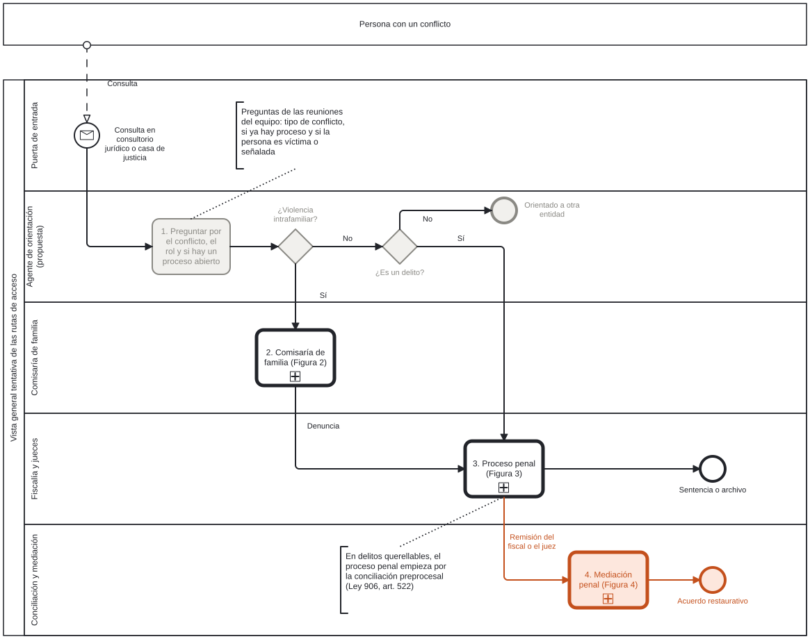
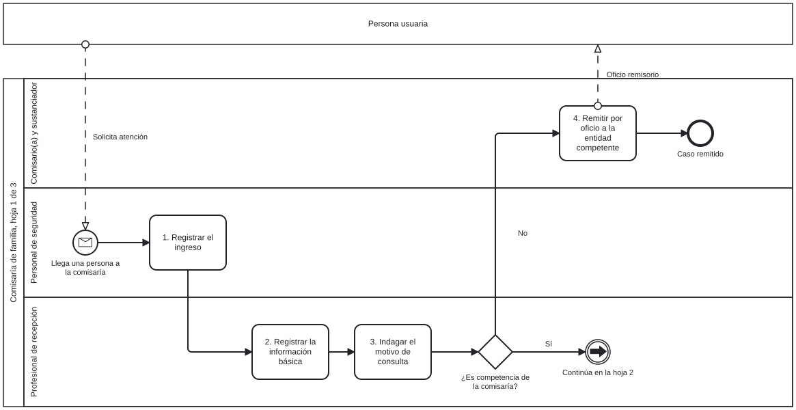
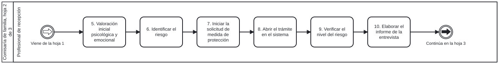
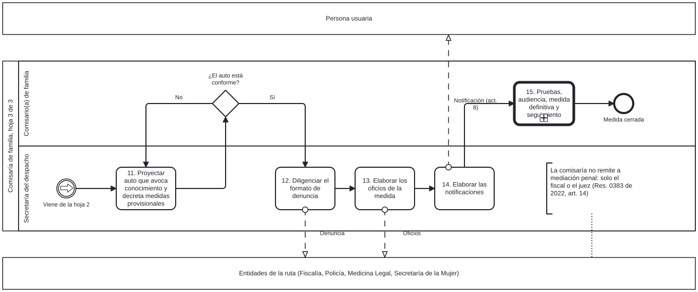
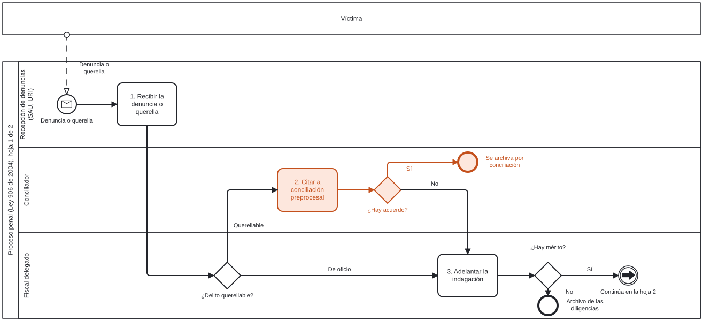
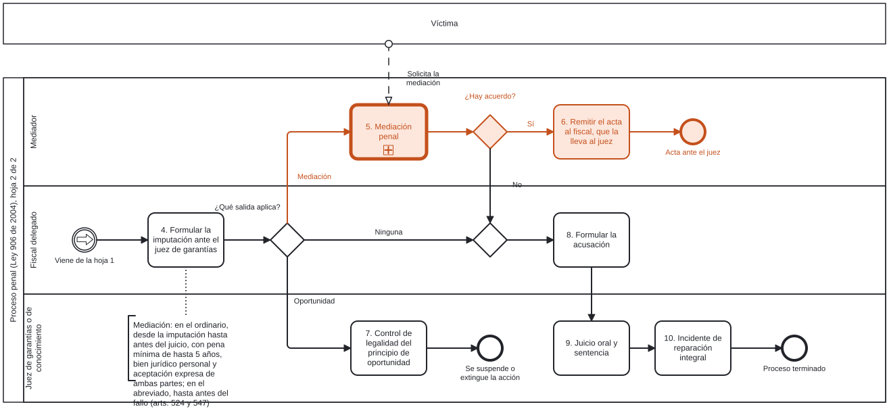
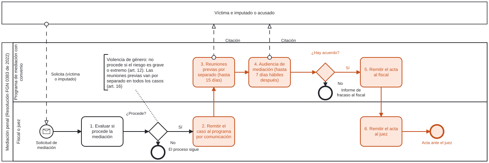

# El Leviatán: el mapa del sistema de justicia

[Inicio](../README.md) · [Estado del arte](01-estado-del-arte.md) · [El Leviatán](02-leviatan.md) · [Validación](03-validacion.md)

> Versión 1, en proceso de validación con el equipo del proyecto.

## 1. Qué entendemos por Leviatán

El término lo propuso Jorge Salcedo, docente de Filosofía e Historia del Derecho de la Javeriana, en la reunión del 28 de octubre de 2026 con el equipo (comunicación personal). Retomando la imagen de Hobbes, Salcedo llamó Leviatán al Estado, entendido como una máquina hipercompleja de procesos y procedimientos frente a la cual las personas se sienten indefensas cuando quieren reclamar o ejercer sus derechos. Aclaró que no lo llama monstruo porque sea malo, sino porque su complejidad hace que, en un Estado tan burocratizado como el colombiano, no existan rutas claras ni un abecé que le diga al ciudadano a dónde ir. En su lectura, los sistemas de justicia son estructuras con actores, procesos, entradas, salidas y un intermedio, cuyas reglas de juego son el derecho sustancial y el procesal.

De esa definición se desprenden dos decisiones para el mapa. En primer lugar, el Leviatán se dibuja completo y no solo en su parte restaurativa, porque, según Salcedo, la justicia restaurativa no se opone a la retributiva, sino que la complementa y está inmersa en el proceso penal; por eso el mapa traza una línea que muestra dónde aparece lo restaurativo dentro del sistema. En segundo lugar, lo que interesa son las bifurcaciones: el momento en que el operador consulta a las partes si quieren una vía restaurativa, que es voluntaria, y lo que ocurre cuando no la toman, que es la vía tradicional de la cárcel, la multa y el incidente de reparación. Como referente de un Leviatán que se puede recorrer, Salcedo citó las unidades de atención y orientación integral que nacieron de la sentencia T-025 de 2004, que le evitan a la víctima tener que lidiar con el Estado entero. El equipo acordó entonces dibujar ese mapa para identificar los vacíos y los puntos de intervención, con la analogía del sistema de salud y sus niveles de atención.

## 2. Cómo se dibuja

Antes de dibujar se buscó si ya existe un mapa de procesos del sistema de justicia colombiano, en fuentes oficiales, en la literatura académica y en Scopus. No existe, ni oficial ni académico: la Fiscalía no publica los procedimientos de sus salas de atención ni de justicia restaurativa, y la única fuente oficial que describe una ruta paso a paso es el Tomo V de los lineamientos del Ministerio de Justicia para las comisarías de familia, que la presenta en texto y sin flujograma ([`busqueda-de-mapas.md`](../metodo/busqueda-de-mapas.md)). Por eso el mapa se construye desde las normas y los lineamientos disponibles, con dos referentes. Por un lado, el Sequential Intercept Model (Munetz y Griffin, 2006), que mapea el sistema penal como una secuencia de puntos donde un caso puede desviarse del proceso ordinario, ordena la vista general. Por otro lado, cada proceso se dibuja en BPMN 2.0, el estándar de notación de procesos de la Object Management Group (2013), que es el que usan Bizagi y Camunda.

Cada lámina tiene un carril por actor, numera sus actividades y asocia a cada una su fuente con artículo o página en una tabla aparte. En naranja va la vía restaurativa y en gris lo que propone el proyecto y falta validar. Además, cada lámina se guarda como archivo `.bpmn`, de modo que el equipo jurídico puede abrirla en Bizagi Modeler, Camunda Modeler o [demo.bpmn.io](https://demo.bpmn.io), corregirla y devolverla, y la figura se regenera desde ese archivo.

## 3. Las láminas

La Figura 1 es la vista general. Una persona consulta en una puerta de entrada, el agente que propone el proyecto le pregunta por su conflicto, su rol y si ya hay un proceso abierto, y según la respuesta el caso va a la comisaría, al proceso penal o a otra entidad. Las preguntas salen de las reuniones del equipo de octubre y por eso van en gris. En cambio, lo que sigue está en la norma: la comisaría denuncia ante la Fiscalía, y solo desde el proceso penal se llega a la mediación.

**Figura 1.** Vista general tentativa de las rutas de acceso

*Nota:* las actividades con el signo + se detallan en las Figuras 2 a 4. En gris, la propuesta del proyecto por validar; en naranja, la vía restaurativa. *Fuente:* Elaboración propia a partir de las reuniones del equipo de octubre de 2026, la Ley 906 de 2004 y la Resolución FGN 0383 de 2022. Archivo editable: [`vista-general.bpmn`](../procesos/vista-general.bpmn).

La Figura 2 detalla una de las puertas de la violencia intrafamiliar, la comisaría de familia, en tres hojas que siguen las dos primeras fases del Tomo V con el responsable de cada actividad. En la primera, la comisaría recibe a la persona y decide si el caso es de su competencia; en la segunda, el equipo psicosocial valora a la víctima y el riesgo; y en la tercera, la secretaría proyecta las medidas provisionales, diligencia la denuncia y notifica. La comisaría no tiene una salida restaurativa propia en lo penal, porque solo el fiscal o el juez remiten a mediación.

**Figura 2.** Recepción de un caso de violencia en el contexto familiar en una comisaría de familia

*Hoja 1.* Recepción y competencia

*Hoja 2.* Valoración del riesgo y entrevista

*Hoja 3.* Medidas provisionales y denuncia

*Nota:* los eventos con flecha unen una hoja con la siguiente. Las actividades 8, 9, 11 y 12 del Tomo V, que se aplican cuando hay niños, niñas o adolescentes, no se dibujan, y las fases 3 a 8 quedan como una sola actividad. *Fuente:* Elaboración propia a partir de Ministerio de Justicia y del Derecho (2022), fases 1 y 2, pp. 17-24. Fuente de cada actividad en [`comisaria-fuentes.md`](../procesos/comisaria-fuentes.md); archivos editables en [`procesos/`](../procesos/).

La Figura 3 dibuja el proceso penal con sus bifurcaciones, que son las que Salcedo pidió mirar. En la primera hoja, si el delito es querellable, el proceso empieza por la conciliación preprocesal, y si hay acuerdo se archiva. Si no lo hay, o si el delito se persigue de oficio, el fiscal indaga. En la segunda, tras la imputación, el fiscal decide entre la mediación, el principio de oportunidad o la acusación. Cuando nadie ofrece la vía restaurativa, el caso sigue a juicio y la reparación se discute en el incidente de reparación integral.

**Figura 3.** Proceso penal y salidas restaurativas

*Hoja 1.* De la denuncia a la indagación

*Hoja 2.* De la imputación a la sentencia

*Nota:* en naranja, las dos salidas restaurativas: la conciliación preprocesal y la mediación. *Fuente:* Elaboración propia a partir de la Ley 906 de 2004 y la Resolución FGN 0383 de 2022. Fuente de cada actividad en [`proceso-penal-fuentes.md`](../procesos/proceso-penal-fuentes.md).

Por último, la Figura 4 abre la mediación penal. La piden la víctima o el imputado, el fiscal o el juez evalúa si procede y la remite a un programa con convenio, que hace reuniones previas por separado y luego la audiencia. Si hay acuerdo, el acta vuelve al fiscal y de ahí al juez; si no, el mediador informa el fracaso y el proceso sigue.

**Figura 4.** Mediación penal

*Fuente:* Elaboración propia a partir de la Resolución FGN 0383 de 2022, arts. 12, 14, 16, 19 y 22, y la Ley 906 de 2004, arts. 524 y 525. Fuente de cada actividad en [`mediacion-penal-fuentes.md`](../procesos/mediacion-penal-fuentes.md).

## 4. Remisiones entre entidades

Una remisión es el envío de un caso de una entidad a otra porque la norma lo obliga o lo permite. Se levantaron 38 remisiones, cada una con su disparador, su plazo, su norma y su grado de verificación, que la Tabla 1 resume por ruta.

**Tabla 1.** Remisiones levantadas por ruta

| Ruta | Remisiones | Obligatorias | Verificadas en la norma | Remisión que condiciona la vía restaurativa |
|---|---:|---:|---:|---|
| Violencia intrafamiliar | 13 | 11 | 9 | La comisaría remite todo caso a la Fiscalía (Ley 2126 de 2021, art. 17, par. 3) |
| Violencia contra la mujer | 5 | 1 | 0 | La casa de justicia remite primero a la Fiscalía a toda mujer víctima (procedimiento PD-AJ-24 de la SDSCJ) |
| Casas de justicia | 4 | 3 | 0 | El Centro de Recepción remite según la tipología del caso a ocho entidades (procedimiento PD-AJ-10) |
| Inasistencia alimentaria | 3 | 1 | 0 | La conciliación de la cuota ocurre antes del incumplimiento, en la comisaría, el ICBF o el consultorio |
| Fiscalía y Ministerio Público | 13 | 9 | 11 | Solo el fiscal o el juez remiten a un programa de mediación con convenio (Res. 0383 de 2022, art. 14) |

*Fuente:* Elaboración propia con datos de [`remisiones.csv`](../datos/remisiones.csv).

Las remisiones confirman lo que muestran las láminas. En la violencia intrafamiliar todos los caminos llevan al fiscal, y ni la comisaría ni la casa de justicia pueden remitir un caso penal a mediación, de modo que la vía restaurativa depende de una decisión del fiscal o del juez y de que exista un programa con convenio. En cambio, en la inasistencia alimentaria la conciliación ocurre antes del incumplimiento y fuera de lo penal, por lo que es el punto restaurativo más accesible para una primera iteración del agente. Además, ninguna norma obliga a una remisión de vuelta: la Fiscalía no tiene que informar a la comisaría o a la casa de justicia qué pasó con el caso que estas le enviaron, y solo la víctima tiene derecho a conocer el trámite (Ley 906 de 2004, art. 136). Por último, 20 de las 38 remisiones están verificadas en el texto de la norma y el resto son citas literales de fuentes oficiales que todavía no se cotejaron en el original, por lo que la tabla es una base para validar con el equipo jurídico y no un resultado cerrado.

## Referencias

Ministerio de Justicia y del Derecho. (2022). *Modelos de justicia local y rural. Tomo V: Lineamientos para el servicio de atención en comisarías de familia*. Ministerio de Justicia y del Derecho.

Munetz, M. R. y Griffin, P. A. (2006). Use of the Sequential Intercept Model as an approach to decriminalization of people with serious mental illness. *Psychiatric Services, 57*(4), 544–549. https://doi.org/10.1176/ps.2006.57.4.544

Object Management Group. (2013). *Business Process Model and Notation (BPMN), versión 2.0.2*. https://www.omg.org/spec/BPMN/2.0.2/
