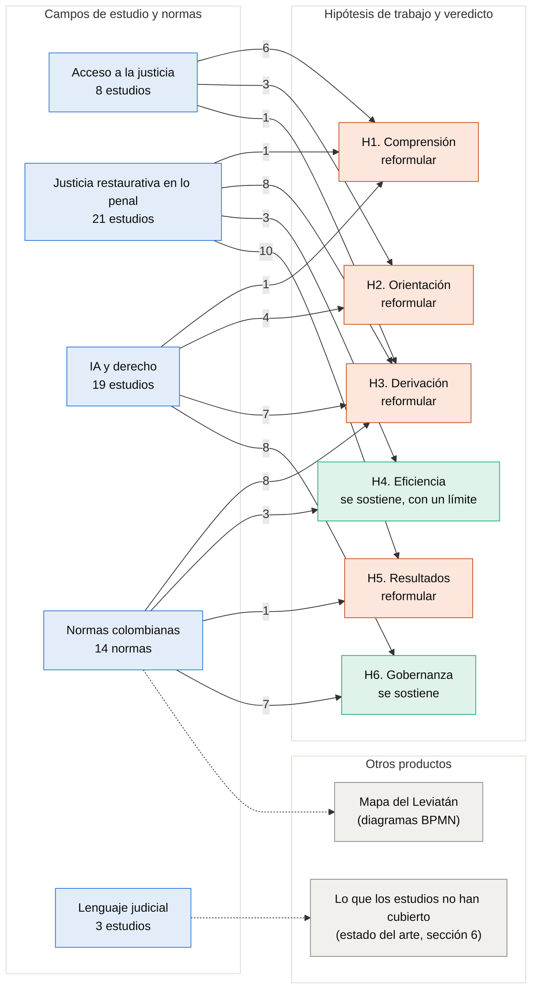
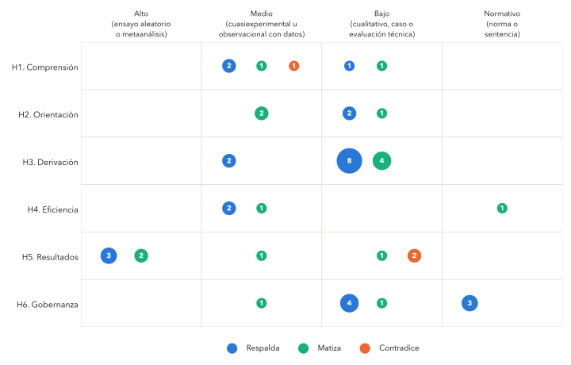

# Evidencia

Esta carpeta reúne la evidencia que sostiene los [documentos](../docs/): qué estudios y normas se leyeron, a qué hipótesis de trabajo aporta cada uno y cómo se verificó cada afirmación contra su fuente.

## Cómo se conecta la evidencia

En la Figura 1, los cuatro campos de estudio de la búsqueda y las normas colombianas aportan textos a las seis hipótesis de trabajo, y cada flecha indica cuántos. Las normas, además, son la base del mapa del Leviatán. En cambio, el lenguaje judicial no aporta a ninguna hipótesis y sustenta lo que la sección 6 del estado del arte describe como no cubierto.

**Figura 1.** Mapa conceptual de la evidencia

*Nota:* en naranja, las hipótesis que hay que reformular; en verde, las que se sostienen; la línea punteada une las normas y el lenguaje judicial con lo que sustentan fuera de las hipótesis. Un mismo texto puede aportar a más de una hipótesis, por lo que las flechas suman más que los textos. Los enunciados de las hipótesis y su veredicto están en la Tabla 3 del [estado del arte](../docs/01-estado-del-arte.md). *Fuente:* Elaboración propia con datos de [`matriz.csv`](matriz.csv).

## Cuánta evidencia hay para cada hipótesis

La Figura 2 es un mapa de brechas de evidencia. H3 es la hipótesis que más evidencia reúne, aunque casi toda de nivel bajo, y solo H5 tiene evidencia de nivel alto, que viene de metaanálisis y revisiones sistemáticas. En cambio, H2 y H4, que sostienen la propuesta del agente, descansan en pocos estudios, de nivel medio o bajo, y ninguna hipótesis tiene evidencia colombiana de nivel alto.

**Figura 2.** Mapa de evidencia por hipótesis y nivel de evidencia

*Nota:* el tamaño del círculo indica cuántos textos aportan, y el color, si respaldan, matizan o contradicen la hipótesis tal como está formulada. Nivel alto, ensayo aleatorio o metaanálisis; medio, estudio cuasiexperimental u observacional con datos; bajo, estudio cualitativo, caso o evaluación técnica de un sistema; normativo, norma o sentencia. Los textos que solo dan contexto no se dibujan. *Fuente:* Elaboración propia con datos de [`matriz.csv`](matriz.csv).

## Matriz de extracción

La matriz tiene una fila por cada uno de los 68 estudios y normas citados en los documentos, con su país, diseño, muestra, hallazgo principal con página, nivel de evidencia y las hipótesis a las que aporta. Se presenta en tablas por campo en [`matriz.md`](matriz.md), y los datos completos están en [`matriz.csv`](matriz.csv).

## Verificación contra las fuentes

Cada afirmación con fuente de los documentos, de las fichas, de las tablas de fuentes de los diagramas y de los datos del Leviatán se cotejó contra el texto original del estudio o de la norma. La Tabla 1 resume el resultado, y el registro completo, con la cita de la fuente y la corrección aplicada, está en [`verificacion.csv`](verificacion.csv).

**Tabla 1.** Resultado de la verificación de 411 afirmaciones

| Resultado | Afirmaciones | Qué se hizo |
|---|---:|---|
| Coincide con la fuente | 287 | Nada |
| Parcial: la idea está, pero el número, el alcance o la página no | 88 | Se corrigió en el documento |
| Difiere de la fuente | 9 | Se corrigió en el documento |
| Sin fuente abierta | 27 | Se declara en el texto o queda como pendiente |

*Nota:* la verificación es del 2 de noviembre de 2026. Las afirmaciones sin fuente abierta son, sobre todo, procedimientos internos de la Secretaría Distrital de Seguridad, Convivencia y Justicia que no están publicados, textos que solo se conocen por su resumen y definiciones que vienen de reuniones del equipo. *Fuente:* Elaboración propia.

## Fichas de lectura

Las fichas guardan las citas literales de cada texto, en el idioma original y con su página impresa. Se distingue lo que el estudio midió (**[DATO]**) de lo que interpreta (**[CONCLUSIÓN DEL AUTOR]**), y las observaciones propias van marcadas como tales.

| Ficha | Qué contiene |
|---|---|
| [`hipotesis.md`](hipotesis.md) | Evidencia de cada una de las seis hipótesis de trabajo |
| [`acceso-restaurativo-y-lenguaje.md`](acceso-restaurativo-y-lenguaje.md) | Diez textos sobre el acceso a la justicia restaurativa y a la mediación penal, y sobre el lenguaje judicial acerca de las víctimas |
| [`ia-juridica.md`](ia-juridica.md) | Seis textos sobre la fiabilidad y los límites de la IA aplicada al derecho |
| [`ia-que-orienta.md`](ia-que-orienta.md) | Once textos sobre IA que orienta, clasifica o deriva, y sobre IA en procesos restaurativos |
| [`lecturas-complementarias.md`](lecturas-complementarias.md) | Cuatro textos complementarios: mediación penal en Chequia, prácticas restaurativas en Uzbekistán, análisis de casos de acceso a la justicia con modelos de tópicos y delitos sexuales juveniles en tribunales |
| [`normas-fiscalia.md`](normas-fiscalia.md) | Normas de la Fiscalía sobre mediación y violencia intrafamiliar |
| [`normas-ia.md`](normas-ia.md) | Lo que exigen las normas colombianas a un agente de IA que orienta sobre la justicia |
| [`derivaciones.md`](derivaciones.md) | Derivaciones de vuelta, Ministerio Público y plazos, con su norma |

Los textos completos no se suben al repositorio, porque sus licencias no permiten redistribuirlos. Los grados de verificación de los datos están en el [diccionario de datos](../datos/DICCIONARIO.md).
